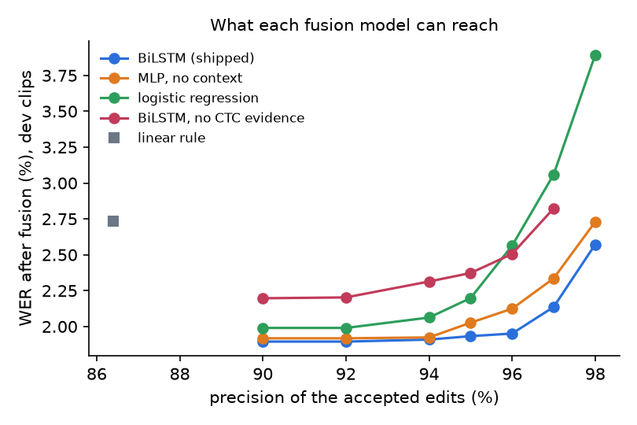
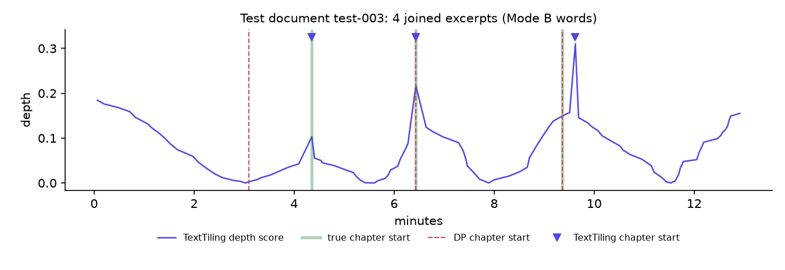

# Audio-Aware Subtitle Correction (English)

Implementation of the course plan in [`imp.md`](imp.md): a modular Python pipeline that
corrects subtitles using the audio as evidence (Mode A: audio + faulty `.srt`/`.vtt`) or
generates and post-corrects them from audio alone (Mode B), with a synthetic-corruption benchmark,
baselines, ablations and a web app (FastAPI backend + React frontend).

> **Results:** see [Results](#results) (filled from `results/` by the evaluation runs).

## Pipeline

```
media ──ffmpeg──► 16 kHz WAV ──faster-whisper──► words + probabilities (cached)
  Mode A: subtitles ─► coarse sync (RANSAC t'=a·t+b on cue-start anchors, piecewise jumps)
                    ─► graded Needleman-Wunsch alignment (anchor-and-fill)
                    ─► evidence fusion (own BiLSTM: confidence, phonetics, LM, CTC check against the audio)
  Mode B: ASR words as the draft
both  ─► punctuation (own BiLSTM) ─► truecasing ─► SymSpell + LanguageTool ─► own Transformer corrector
      ─► audio-consistency guard ─► CTC forced alignment (own acoustic model)
      ─► [speaker diarization, opt-in: own speaker model] ─► DP re-segmentation (own POS tagger, speaker-aware)
      ─► cue timing rules ─► .srt / .vtt / change log / HTML diff [+ .rttm / speaker statistics]
      ─► chapter markers: topic segmentation of the corrected words (own POS tagger + LM unigrams)
         ─► .chapters.vtt / .ffmetadata / .chapters.txt / .chapters.json   (the second output)
```

Whisper is the only pretrained model in the default pipeline. The fusion network, fusion LM,
punctuation tagger, corrector, POS tagger and forced aligner are our own, trained from scratch on
this machine (see [Self-trained models](#self-trained-models) and [Neural fusion](#neural-fusion)).
The optional speaker labels use our own speaker
model too (trained from scratch, no pretrained model), and are off unless you turn them on (see
[Speaker diarization](#speaker-diarization)).

| Module | What it does |
|---|---|
| `src/subfix/subio.py` | `Word`/`Cue` model, SRT/VTT parse + write, tag stripping, sound-event tokens |
| `src/subfix/asr.py` | faster-whisper wrapper (word timestamps + probabilities, JSON cache, GPU→CPU fallback) |
| `src/subfix/sync.py` | anchor-based RANSAC offset/drift fit, piecewise offset jumps, ffsubsync wrapper (B2) |
| `src/subfix/align.py` | graded NW: 0 exact / 0.3 metaphone-equal / 0.4+0.6·d near miss / 1; gap 0.8; time penalty |
| `src/subfix/fuse.py` | candidate edits and their signals, imp.md §4.1 linear decision rule (confidence, phonetics, LM delta, OOV, lexicon), split/merge units |
| `src/subfix/fusenet.py` | neural fusion: CTC audio evidence (log P(audio \| text after the edit) − before it), the BiLSTM keep/edit tagger, dev-tuned thresholds per candidate kind |
| `src/subfix/lm.py`, `ngram.py` | window scorer on our modified Kneser-Ney 4-gram LM (NumPy, open vocabulary) |
| `src/subfix/textfix/` | punctuation (our BiLSTM), truecasing, SymSpell + LanguageTool, our Transformer corrector (`seq2seq.py`, BPE in `bpe.py`) with ratio guard, audio guard |
| `src/subfix/timing.py`, `acoustic.py` | our CTC acoustic model (log-mel + conv + BiLSTM) + NumPy CTC Viterbi, or Whisper DTW timings; cue rules |
| `src/subfix/segment.py`, `postag.py` | greedy and POS-aware DP segmentation (≤42 chars, ≤2 lines, CPS, 0.833–7 s, gaps; speaker-aware with labels); our averaged-perceptron POS tagger |
| `src/subfix/speaker.py` | our speaker-embedding network (x-vector style TDNN + attentive pooling, AAM-softmax), energy speech activity, clustering, the diarizer |
| `src/subfix/diarize.py` | optional speaker diarization (cached), words → speakers, overlapping speech, speaker turns and statistics, labels, RTTM |
| `src/subfix/chapters.py` | chapter markers: Utiyama-Isahara DP or TextTiling over sentences, content words from our POS tagger, generic words filtered with our LM's unigrams, titles and descriptions, WebVTT / FFmpeg / timestamp-list writers |
| `src/subfix/pipeline.py` | Mode A / B orchestration, text-stage cache, model registry (6 GB GPU budget) |
| `metrics/` | WER/CER, edit and ERRANT F0.5, over-correction, GLEU/BLEU, punctuation F1, timing, format, topic segmentation (Pk, WindowDiff, boundary F1) |
| `tools/` | data download, long-form clips, MFA references, corruption generator, benchmark builder |
| `experiments/` | `train_{lm,pos,punct,corrector,aligner,fusion}.py`, `fusion_data.py`, `fusion_results.py`, `run_eval.py`, `systems.yaml`, `tune_fusion.py`, `eval_chapters.py`, `plots.py`, Colab notebook |
| `app/backend/` | FastAPI server: job queue (one GPU job at a time), SQLite history, REST + Server-Sent Events API |
| `frontend/` | React + TypeScript (Vite) app: upload, live progress, player with captions, diff, cue editor |

### Design decisions that differ from imp.md (and why)

* **Anchor-and-fill alignment instead of per-cue ±2 s windows** — overlapping windows can match or
  insert the same ASR word twice; unique n-gram anchors (LIS-monotonic) + NW between them is still
  linear in file length.
* **Cue-start anchors for sync** — word times inside a cue are only interpolated (badly off for
  merged cues) and cue ends include reading-time extensions; cue starts are the reliable times.
* **Audio-consistency guard** — SymSpell, LanguageTool and the corrector may not substitute/delete a
  word the ASR heard with p ≥ 0.8 (nor insert words between such words). Without it SymSpell
  "corrected" `ravishment`→`banishment` and the earlier T5 model hallucinated "compared *to that
  which is in the water*" on a LibriSpeech clip. Punctuation/casing changes are always allowed.
* **Self-trained models instead of pretrained ones** — imp.md suggests distilgpt2, FullStop XLM-R,
  T5/CoEdIT, MMS-300M and spaCy; all five are replaced by models trained here from scratch
  (an earlier version used them; its numbers are kept in `results/pretrained_v1/` for comparison).
* **A neural network instead of the §4.1 linear rule** — imp.md §4.2 proposes a learned logistic
  regression as a stretch goal and §6.3 an ablation "rules vs learned". We train that logistic
  regression too, but ship a small BiLSTM that also checks each edit against the audio; the rule stays
  available (`--fusion-method rule`). See [Neural fusion](#neural-fusion).
* **Word times from non-blank CTC frames** — a word starts at its first non-blank character frame
  and ends after its last one; padding words into the neighbouring silence (as `ctc-forced-aligner`'s
  `get_spans` does) gave ~0.5 s early subtitle onsets.
* **Whisper `initial_prompt`** — without a punctuated prompt large-v3-turbo sometimes returns
  lowercase, unpunctuated text, which removes the casing evidence used by fusion.
* **Re-merged number pieces** — faster-whisper's word timestamps split "10,000" into "10" + ",000";
  these pieces (and punctuation-only pieces) are merged back into one word before alignment.
* **Onset-based cue timing metric** — matching cues by overlap mixes segmentation differences into
  timing errors; the primary metric is the cue start vs the MFA start of its first word (the
  imp.md cue-pair metric is still reported, with strict Jaccard ≥ 0.8 matching).
* **WhisperX not installed** — Whisper DTW timestamps remain available as the `whisper` timing backend.
* **One punctuation label per word** — the tagger labels whole words (not sub-word pieces), so
  word-level timing and provenance survive punctuation restoration.

## Self-trained models

Whisper (faster-whisper large-v3-turbo, with its Silero VAD) is the only pretrained model the
pipeline runs. Everything else was implemented and trained from scratch in this repository, in plain
PyTorch / NumPy (no `transformers`, no downloaded weights), on the RTX 4050 laptop.
A 30-page report on how they were built (architectures, layer-by-layer parameters, code, data,
results, difficulties, viva Q&A) is in `docs/report/Subfix_Self_Trained_Models.pdf`; rebuild it from
the current models and results with `python docs\report\build_report.py`. The report predates the
fusion network, which is described in [Neural fusion](#neural-fusion) below.

| Component | Replaces | Our model | Training data | Size | Training | Held-out result |
|---|---|---|---|---|---|---|
| Fusion LM (`ngram.py`, `lm.py`) | distilgpt2 (82M) | interpolated modified Kneser-Ney 4-gram, open vocabulary (`<unk>` × character-bigram spelling model), vectorized NumPy counting/lookup | LibriSpeech-PC train text: 563k sentences, 8.5M words | 55.8k words, 13.4M n-grams (237 MB) | 2 min, CPU | perplexity 284 on dev-clean (0.9% OOV) |
| POS tagger (`postag.py`) | spaCy `en_core_web_sm` | averaged perceptron, Brown tags mapped to UD | Brown corpus, 54k sentences | 127k features | 3 min, CPU | 97.2% accuracy (2.9k held-out sentences) |
| Punctuation (`textfix/punct.py`) | FullStop XLM-R large (560M) | word + char-CNN + casing embeddings → 2-layer BiLSTM → {none . , ?} | LibriSpeech-PC train chapters, 8.5M words, half lowercased | 12.3M params | 8 epochs, 40 min | macro-F1 0.81 cased / 0.67 lowercased (dev-clean + dev-other) |
| Corrector (`textfix/seq2seq.py`, `bpe.py`) | vennify T5-base (220M), CoEdIT-large (770M), fine-tuned T5-small (60M) | Transformer encoder-decoder (4 + 3 layers, d = 256), own 8k BPE, beam search | 513k LibriSpeech-PC train sentences with fresh synthetic noise every epoch + real whisper-tiny confusions | 8.4M params | 15 epochs, 76 min (best: epoch 13) | WER 13.9% → 4.3% on noisy dev-clean sentences; 97.6% of clean sentences left unchanged |
| Forced aligner (`acoustic.py`, `timing.py`) | MMS-300M (`ctc-forced-aligner`), wav2vec2-base-960h | 80-band log-mel → 2 conv (20 ms frames) → 4-layer BiLSTM → CTC over 29 characters; our NumPy Viterbi with wildcard edges | LibriSpeech train-clean-100 (28.5k utterances, 100.6 h, 251 speakers) | 9.3M params | 11 epochs, 2 h 56 min | CER 7.9% (greedy, dev-clean); word onsets vs MFA on the dev clips: 25 ms mean / 19 ms median error, 98.6% within 100 ms, after removing the constant 47 ms CTC lag |
| Evidence fusion (`fusenet.py`) | imp.md §4.1 linear rule | candidate kind + 28 signals, including CTC evidence from our aligner → 2-layer BiLSTM (32 units each way) → keep or edit, per candidate kind | 129k candidate edits in 24.8 h of audio, from synthetic corruption of 325 clips | 100,019 params | 14 epochs at most, 2.8 min (best: epoch 7) | dev clips, fusion stage: F0.5 0.936 vs 0.860 for the rule, WER 1.99% vs 2.73%. Test: [Neural fusion](#neural-fusion) |

Evaluation-only tools still use pretrained models, because they measure the system rather than
being part of it: MFA (`english_us_arpa`) for the silver-gold timing references, spaCy inside ERRANT
and for the reference cue breaks (`tools/make_refs.py`), and whisper-tiny for the real-ASR-error
corruptions (`tools/corrupt.py`) and the corrector's confusion table.

## Neural fusion

Evidence fusion decides, wherever the subtitle and Whisper disagree, whether to take Whisper's word.
imp.md §4.1 writes that decision as a linear rule and §4.2 suggests logistic regression as a stretch
goal. We trained logistic regression and a small neural network that also checks each edit against
the audio, and ship the network, which did best on the dev clips. The rule stays available
(`--fusion-method rule`, or *Who decides each word change* in the web app), and the pipeline falls
back to it when `models/fusion` is missing.

**Result on the 27 test files, against the rule:**

* **Half the wrong edits.** Over-correction 0.70% vs 1.39%, edit precision 88.7% vs 82.5%, Edit F0.5
  87.3 vs 82.3 (paired difference +5.0, 95% CI +2.8 to +6.8).
* **The same errors repaired.** Edit recall 81.9% vs 81.4%.
* **A small WER lead that is not significant.** 2.54% vs 2.72%: −0.18 points (−0.44 to +0.09).
* **Slower.** RTF 0.081 vs 0.056. The audio check accounts for all of it.
* **Most of the gain is not depth.** Logistic regression on the same signals ties the network on WER
  and is 1.5 points behind on Edit F0.5. The learned weights and the audio check matter more than
  the BiLSTM.

**Why this feature.** We looked at where a neural model could replace part of the pipeline while
keeping Whisper as the only pretrained model.

| Feature | Neural work we looked at | Verdict |
|---|---|---|
| **Evidence fusion** | Keep/edit tagging ([GECToR](https://ar5iv.labs.arxiv.org/html/2005.12592)); word confidence for end-to-end ASR ([evaluation](https://arxiv.org/pdf/2101.05525), [RNN-T](https://arxiv.org/abs/2110.15222), [Hystoc](https://arxiv.org/abs/2305.12579v1)); a Bi-LSTM detection module over text and audio features ([CMC-SC](https://aclanthology.org/2025.icnlsp-1.26/)) | **Chosen.** It is the core of the project and was still a linear rule. There was room: on the dev clips the rule left 2.73% WER where perfect decisions give 1.30%. We can generate training data here. |
| Subtitle line breaks | Learned from subtitle corpora ([MuST-Cinema](https://arxiv.org/pdf/2002.10829), [Dodging the Data Bottleneck](https://arxiv.org/pdf/2209.10608)) | Needs a new corpus, cannot change WER, and the DP already meets the line rules for every cue. |
| Chapter markers | Supervised segmentation ([Koshorek et al.](https://aclanthology.org/N18-2075/)), BERT embeddings for meetings ([Solbiati et al.](https://arxiv.org/pdf/2106.12978)), [TreeSeg](https://arxiv.org/html/2407.12028v1) | AMI's 139 meetings are too few to train an encoder from scratch, and BERT would break the own-models rule. |
| Speaker diarization | End-to-end segmentation ([powerset loss](https://arxiv.org/pdf/2310.13025)) | Opt-in feature, evaluated only on synthetic conversations, and a much larger job. |
| Fusion LM, POS tagger | Neural LM, BiLSTM tagger | Removing the LM changes little (see the ablations), and the tagger is already at 97.2%. |

**The network** (`src/subfix/fusenet.py`) reads the whole aligned word sequence, so each decision
sees its neighbours. It answers one question per candidate: does this edit improve the subtitle?

```
for every aligned word, matches included:
    candidate kind (8-d embedding) + 28 signals ──► linear to 128 ──► 2-layer BiLSTM (32 units each way)
                                        │                 │                     │
                                        └─────────────────┴─────────────────────┴──► 128 ──► P(sub), P(ins), P(del)
```

The 28 signals:

* **Whisper:** word probability, confidence of the span around it, word duration, gap before it.
* **The pair:** phonetic similarity, alignment cost, time offset between subtitle and ASR word.
* **The text:** LM difference; out-of-vocabulary flag, frequency, capital letter and length of each
  word; duplicate, filler and function-word flags; whether the previous word ends a sentence; whether
  the input has any casing.
* **The audio:** five features from the check described next.

An edit is accepted when its probability passes a threshold tuned on the dev clips: 0.5 for
substitutions, 0.7 for insertions, 0.5 for deletions. Terms from the user's lexicon face half of that.
The hard rules stay: sound events are never changed, fillers are never inserted, and split/merge
candidates keep their OOV rule.

**Asking the audio directly.** Whisper's confidence says how sure Whisper was of its own word. It does
not compare the two texts. So for each candidate we take the words around it (two Whisper words on
each side, 0.15 s margin, 10 s at most) and ask our CTC acoustic model, the forced aligner we already
trained, which text the audio prefers:

```
evidence = log P(audio | text after the edit) − log P(audio | text before it)
```

This is what lets the network tell a word really said twice ("I I think", which Whisper tends to
drop) from a word the subtitle duplicated. For deleting a duplicated word on the dev clips, the
evidence separates good from bad edits with AUC 0.86 on LibriSpeech and 0.97 on TED, where Whisper's
confidence gives 0.78 and 0.54. Checking a transcript against an acoustic model is known from work on
finding errors in training data ([WenetSpeech](https://ar5iv.labs.arxiv.org/html/2110.03370),
[Wang et al.](https://www.isca-archive.org/interspeech_2019/wang19j_interspeech.pdf),
[Kurata et al.](https://www.isca-archive.org/interspeech_2011/kurata11_interspeech.html)) and on
aligning disfluent speech ([CTC with repetitions and omissions](https://arxiv.org/abs/2306.00996)). We
did not find a paper that feeds it to a network choosing word by word between a human transcript and
ASR output, though our search was not exhaustive.

**Training data** (`experiments/fusion_data.py`, `experiments/train_fusion.py`).

* **Clips:** 325 clips, 24.8 h of audio: LibriSpeech dev-clean speakers outside the benchmark, one
  train-clean-100 chapter per speaker, and four TED talks outside the benchmark, sampled up to a
  quarter of the training windows.
* **Candidates:** synthetic corruptions (5.5%, 11% twice and 22% of words) go through the real sync,
  alignment and candidate code. That gives 129,063 candidates among 968,758 aligned words; 86.6% of
  the candidates are good.
* **Labels by effect:** a candidate is good if applying it lowers the edit distance to the reference.
  Labels taken from the position of the injected error would be wrong for duplicates, where either
  copy may go: they found 10 good deletions on the dev clips where 107 lower the distance.
* **Training:** binary cross-entropy per candidate, windows of 200 words, 2.8 min on the RTX 4050.
  Whisper and the features take about 1.5 h once.
* **No choice was made on the test clips.** The variant, its thresholds and its best epoch come from
  the 12 dev clips, and the test files were run once, after all of those were fixed. No benchmark
  speaker or talk is in the training data.

**Making the comparison fair.** Two early results flattered the network, and both were corrected
before the test run.

* **The language model had seen the training text.** Our LM trained on the sentences of
  train-clean-100, so it ranked those candidates far better than unseen text (AUC for substitutions
  0.93 vs 0.83 on dev-clean), and a network trained on that would trust the LM too much. Those clips
  now use an LM trained without them (0.84). Our CTC model has almost no such gap (0.70 vs 0.66).
* **The rule was tuned for a different goal.** F0.5 is nearly flat around its peak while WER is not,
  so tuning the rule on F0.5 alone left it at 3.14% WER on the dev clips, against 2.73% at about the
  same F0.5 (0.863 vs 0.860). The rule and the network now share one selection score,
  F0.5 − 0.01 × WER%. This shrank the network's dev lead in the whole pipeline from 0.86 to 0.39
  points. The F0.5-only rule stays in the ablation, since it is imp.md's literal wording.

**Dev clips.** F0.5, precision, recall and WER after fusion are the mean of three training seeds over
36 corrupted versions of the 12 clips. The whole-pipeline columns are the first seed on the official
corruption. Differences of about 0.1 to 0.15 points in whole-pipeline WER between runs are noise.

| Who decides | Params | F0.5 | Precision | Recall | WER after fusion % | Whole pipeline WER % | Whole pipeline over-corr. % |
|---|---:|---:|---:|---:|---:|---:|---:|
| Linear rule, tuned on F0.5 alone | 9 | 0.863 | 0.881 | 0.799 | 3.14 | 3.32 | 1.48 |
| Linear rule, same selection score | 9 | 0.860 | 0.864 | 0.845 | 2.73 | 2.85 | 1.58 |
| Logistic regression | 87 | 0.922 | 0.950 | 0.824 | 2.18 | 2.54 | 0.87 |
| MLP per candidate (no context) | 25,267 | 0.932 | 0.965 | 0.819 | 2.16 | 2.64 | 0.75 |
| **BiLSTM, 32 units (shipped)** | 100,019 | **0.936** | 0.966 | 0.833 | **1.99** | **2.46** | 0.81 |
| BiLSTM, 64 units | 240,307 | 0.936 | 0.968 | 0.828 | 2.04 | 2.58 | 0.80 |
| BiLSTM, 128 units | 717,491 | 0.936 | 0.967 | 0.830 | 2.02 | 2.54 | 0.79 |
| BiLSTM + word and character embeddings | 511,667 | 0.930 | 0.963 | 0.821 | 2.15 | 2.55 | 0.78 |
| BiLSTM without the CTC evidence | 100,019 | 0.923 | 0.962 | 0.793 | 2.52 | 2.88 | 0.80 |

* **Learned weights and the audio check give most of the gain.** Logistic regression alone moves F0.5
  from 0.860 to 0.922.
* **Depth buys precision.** The models nearly meet at low precision. At precision ≥ 0.97 the lowest
  WER after fusion is 2.14% for the BiLSTM, 2.34% for the MLP and 3.06% for logistic regression.
* **Size barely matters.** All three BiLSTMs tie on F0.5, so we ship the smallest.
* **Word embeddings overfit.** Knowing the words themselves lowers the AUC on unseen clips (substitutions
  0.935 vs 0.948, insertions 0.911 vs 0.934).



**An error type it never saw.** The benchmark's corruption generator also made the training data, so
the network could simply be memorising it. To test that, we trained on dev-clean + TED only, leaving
one error type out of the training corruptions each time.

| Recall on the dev clips % | Rule | Network, all types | Network, this type left out |
|---|---:|---:|---:|
| Entities | 89 | 82 | 84 |
| Real whisper-tiny errors | 46 | 36 | 37 |
| Homophones | 98 | 98 | 98 |
| Spelling | 97 | 98 | 98 |
| Dropped words | 94 | 96 | 95 |
| Duplicated words | 86 | 83 | **31** |

Five of the six types are repaired just as well without having been seen. Duplicates collapse. The
likely reason is that most repeated words in clean transcripts were really said, so without examples
of duplicated subtitle words the network learns to keep repeats. A new kind of error that looks unlike
anything in training could be missed the same way.

**Test files.** The ablation's 19 files (libri-test-clean + ted-test); the rule's row on all 27 files
is in [Results](#results). Tables: `results/ablations/fusion_method/`, `results/SUMMARY.md`.

| Who decides | Params | WER % | Edit F0.5 | Over-corr. % | Whisper-tiny error recall % | Duplicate recall % | RTF |
|---|---:|---:|---:|---:|---:|---:|---:|
| Linear rule, tuned on F0.5 alone | 9 | 3.16 | 80.3 | 1.31 | 23.5 | 87.2 | 0.063 |
| Linear rule, same selection score | 9 | 2.77 | 81.4 | 1.41 | 38.4 | 86.3 | 0.063 |
| Logistic regression | 87 | **2.62** | 85.2 | 0.81 | 41.2 | 81.8 | 0.082 |
| MLP per candidate (no context) | 25,267 | 2.70 | 86.4 | 0.65 | 33.6 | 85.0 | 0.082 |
| BiLSTM + word and character embeddings | 511,667 | 2.72 | 86.0 | 0.69 | 35.7 | 83.7 | 0.084 |
| BiLSTM without the CTC evidence | 100,019 | 2.88 | 86.2 | **0.61** | 33.8 | 65.8 | 0.062 |
| **BiLSTM, 32 units (shipped)** | 100,019 | 2.63 | **86.7** | 0.68 | 37.3 | 85.6 | 0.085 |

Paired over test files (10,000 bootstrap resamples of the files; negative WER and positive F0.5 favour
the network; bold when the interval excludes zero):

| Network minus | WER points (95% CI) | Edit F0.5 points (95% CI) | Files with lower WER |
|---|---|---|---:|
| Linear rule, all 27 files | −0.18 (−0.44 to +0.09) | **+5.0 (+2.8 to +6.8)** | 14 of 27 |
| Raw Whisper, all 27 files | −0.56 (−1.35 to +0.05) | **+16.6 (+13.1 to +19.2)** | 17 of 27 |
| Linear rule tuned on F0.5 alone | **−0.53 (−0.82 to −0.22)** | **+6.4 (+3.9 to +8.3)** | 15 of 19 |
| Logistic regression | +0.01 (−0.11 to +0.14) | **+1.5 (+0.6 to +2.6)** | 8 of 19 |
| MLP per candidate | −0.07 (−0.15 to +0.02) | +0.3 (−0.3 to +0.9) | 11 of 19 |
| Network + word and character embeddings | **−0.08 (−0.15 to −0.01)** | **+0.7 (+0.2 to +1.3)** | 11 of 19 |
| Network without the CTC evidence | **−0.25 (−0.36 to −0.13)** | +0.5 (−0.3 to +1.4) | 12 of 19 |

* **Against the rule, the win is precision.** Edit F0.5 is significantly better and over-correction
  halves, while recall per error type stays about the same. The WER lead cannot be told from zero, and
  it is smaller than on dev (0.18 vs 0.39 points). On test-clean the network is slightly behind the
  rule (2.22% vs 2.16%); on test-other and TED it is ahead (2.02% vs 2.44%, 2.72% vs 2.90%).
* **Against raw Whisper, Edit F0.5 is a clear win and WER nearly one.** The WER interval just
  includes zero. See [Results](#results) for the split by dataset.
* **The audio check is the part that clearly earns its cost.** Without it WER rises by 0.25 points and
  duplicate recall falls from 85.6% to 65.8%.
* **Context is not shown to help much.** The MLP is within noise of the BiLSTM on both measures, and
  logistic regression ties on WER. If simplicity matters more than about 1.5 points of Edit F0.5,
  logistic regression with the audio check is a fair choice: 87 parameters, no recurrent network.
  The BiLSTM stays the default because it was chosen on dev before this table existed.
* **The corrector gives some of this back.** It deletes repeats the network chose to keep. Without
  it the network reaches 2.42% WER and Edit F0.5 88.7 on these 19 files (see the
  [corrector ablation](#results)).

**Where it still goes wrong** (the shipped network on the official dev corruption: 1017 right edits,
38 wrong, 52 good ones missed; most of both errors are on TED).

* **Half of the wrong edits have strong audio support** (evidence above +5, for example "ask **for**
  our prescriptions"). The reference may differ from what was said, which would make some of them
  correct, but we have not listened to them.
* **Homophones** such as rain/reign and sole/soul: the audio cannot separate them, and the context
  signals do not always do so.
* **Garbled TED spans and disfluencies.** Names like Blaise Agüera y Arcas, and false starts that the
  reference leaves out, are often missed.
* **Old spellings in LibriSpeech references** ("some one", "for ever") count as harm when the edit
  modernises them.

**Limits.**

* The benchmark is synthetic corruption scored against verbatim transcripts. Real subtitles, and
  condensed professional ones in particular, are untested.
* Training and test corruptions come from the same generator, and the left-out test above shows what
  that can hide.
* Only four TED talks are in the training data and four in dev, and TED is where most errors remain.
* The whole-pipeline dev columns use one seed.
* A BiLSTM training run can end with exit code 0xC0000409 on Windows after everything is saved. It
  also happens with plain PyTorch outside this project, and did not affect the saved models.

## Setup (Windows, RTX-class GPU or CPU)

```powershell
powershell -ExecutionPolicy Bypass -File scripts\setup_env.ps1      # .venv, CUDA torch, deps, MFA env
.venv\Scripts\python scripts\prefetch_models.py                     # Whisper models (~2.5 GB) + check of our models
.venv\Scripts\python -m pytest                                      # unit + property tests
.venv\Scripts\python -m pytest -m integration                       # 3 golden clips (needs models)
```

Requirements: Python 3.11, Java ≥ 17 for LanguageTool (`JAVA_HOME`), conda for MFA, ffmpeg.
`scripts/fetch_resumable.ps1` resumes large downloads on unstable connections;
`scripts/fetch_parallel.sh` splits one into parallel range requests when a single connection is slow.
Train our models once (every run resumes from `models/*/last.pt`):

```powershell
.venv\Scripts\python experiments\train_lm.py          # ~2 min, CPU
.venv\Scripts\python experiments\train_pos.py         # ~3 min, CPU
.venv\Scripts\python experiments\train_punct.py       # ~40 min, GPU
.venv\Scripts\python experiments\train_corrector.py   # GPU
.venv\Scripts\python tools\fetch_data.py --libri train-clean-100   # 6.3 GB of training audio
.venv\Scripts\python experiments\train_aligner.py     # GPU
.venv\Scripts\python experiments\fusion_data.py       # ~1.5 h, GPU, after the aligner and the benchmark below: Whisper on 24.8 h of audio, then features
.venv\Scripts\python experiments\train_fusion.py      # ~3 min, GPU; without this model the pipeline uses the linear rule
```

## Usage

```powershell
# Mode A: correct existing subtitles
.venv\Scripts\subfix correct --media talk.mp4 --subs talk.srt --out outputs
# Mode B: audio only
.venv\Scripts\subfix correct --media talk.mp4 --out outputs
# chapter markers for a meeting or discussion (default: talk, lecture, audiobook)
.venv\Scripts\subfix correct --media meeting.mp4 --chapter-mode meeting --out outputs
# overrides, domain terms
.venv\Scripts\subfix correct --media a.wav --subs a.vtt --set segment.max_cps=20 gec.enabled=false --lexicon "Kubernetes, Chennai"
# who decides each word change: our network (default) or the linear rule
.venv\Scripts\subfix correct --media talk.mp4 --subs talk.srt --fusion-method rule --out outputs
# web app (see "Web app" below)
powershell -ExecutionPolicy Bypass -File scripts\start_app.ps1   # builds the frontend once, serves http://127.0.0.1:8000
```

Outputs: `*.srt`, `*.vtt`, `*.changes.json` (every edit with stage, rule, ASR word, probability,
fusion score), `*.diff.html`; with `--diarize` also `*.rttm` and `*.speakers.json`; when the media
is long enough for two or more chapters, the chapter markers `*.chapters.vtt`, `*.ffmetadata`,
`*.chapters.txt` and `*.chapters.json` (`--chapters N` asks for exactly N, `--no-chapters` turns them
off, `--chapter-mode meeting` tunes them for meetings; see
[Chapter markers](#chapter-markers-second-output)).

## Speaker diarization

Optional: identify who is speaking and label the cues (`SPEAKER_00: ...`). Off by default; the
benchmark numbers below are all without it. No pretrained model is used: the speaker model is our own,
trained from scratch (`src/subfix/speaker.py`).

**How it finds the speakers.**

1. **Speech activity:** frames whose log-energy is above the recording's noise floor by 30 % of the
   noise-to-loud-speech range (5th / 95th percentile), gaps < 0.3 s filled, blips < 0.25 s dropped.
2. **Speaker embeddings:** windows of 1.5 s (hop 0.5 s) inside the speech go through our speaker
   network: 64-band log-mel → five TDNN layers (1-D convolutions, dilations 1-2-3-1-1) → attentive
   statistics pooling → a 192-d embedding (1.24 M parameters). It was trained as a 251-way speaker
   classifier with an additive angular margin softmax on LibriSpeech train-clean-100, so the same
   voice gives embeddings that point in the same direction.
3. **Clustering:** average-linkage agglomerative clustering on cosine distance, cut at a threshold
   tuned on synthetic dev-clean conversations (stored with the model) or at `--speakers N`, then a few
   k-means passes that move each window to its nearest speaker centroid.
4. **Turns:** each 10 ms speech frame takes the speaker whose windows over it fit best; turns shorter
   than 0.5 s are absorbed by their neighbours. One speaker at a time (no overlapping speech).

**Setup (once).** Train the model (~2 h on the 6 GB GPU, resumable) and tune the threshold:

```powershell
.venv\Scripts\python experiments\train_speaker.py            # -> models/speaker/model.pt (best dev-clean EER)
.venv\Scripts\python experiments\eval_diarize.py --stage tune # clustering threshold on dev-clean conversations
.venv\Scripts\python experiments\eval_diarize.py --stage test # DER table -> results/diarize/results.md
```

**Results** (`results/diarize/results.md`). The test set is 60 synthetic conversations (2.6 h) of 2-5
test-clean speakers taking turns of 1-15 s. None of these speakers were in training, and there is no
overlapping speech. DER is measured with a 0.25 s collar, and the threshold was tuned on 32 dev-clean
conversations. The embedding reaches 5.05 % equal error rate on 4000 dev-clean verification trials.

| System | DER % | Confusion % | Speaker count exact | 2 spk | 3 spk | 4 spk | 5 spk |
|---|---:|---:|---:|---:|---:|---:|---:|
| MFCC statistics (untrained, same clustering) | 18.44 | 17.09 | 40 % | 18.45 | 13.15 | 16.75 | 25.26 |
| **Own speaker model** | **8.76** | 7.41 | 52 % | 14.00 | 7.41 | 6.68 | 6.96 |
| Own speaker model, number of speakers given | 4.66 | 3.31 | 100 % | 4.91 | 2.04 | 7.23 | 4.41 |

Most of the remaining error comes from estimating the number of speakers: two-person conversations
are sometimes split into three. Pass `--speakers N` when you know it. Missed speech is 1.35 % and false
alarm is 0, but this is clean read speech; real meetings will be harder.

```powershell
.venv\Scripts\subfix correct --media meeting.mp4 --out outputs --diarize                 # estimate the speakers
.venv\Scripts\subfix correct --media meeting.mp4 --out outputs --speakers 3              # exactly 3 speakers
.venv\Scripts\subfix correct --media talk.mp4 --subs talk.srt --out outputs --labels change   # name only at changes
```

The same settings live in `configs/default.yaml` under `diarize:` (`--set diarize.max_speakers=4` etc.);
in the web app they are under *Settings → Audio → Identify speakers*.

**What happens.** Diarization runs on the 16 kHz audio after forced alignment (cached by audio
content + model + settings, like the ASR). A diarization has two views: regular turns, which may
overlap, and an exclusive view with one speaker at a time. Our diarizer gives one speaker at a time,
so both are the same; the overlap handling below applies to turns that do overlap.

* **Words → speakers:** each word gets the speaker with the largest overlap in the exclusive view;
  words in a diarization gap take the nearest turn within `max_gap` (1 s), else their neighbours'
  speaker; a one-word "island" covered less than `smooth_cover` (50 %) by its own turn joins the
  speaker of the words on both sides (boundary jitter, not a real interjection).
* **Overlapping speech:** words with ≥ `overlap_min` (50 %) of their duration inside overlapping
  speech are flagged (`overlap_with` in the change log, an *overlap* chip and filter in the web app).
  Whisper transcribes one stream, so in a handover overlap (B starts while A finishes) the exclusive
  view cannot know whose words were heard. The overlapped words are therefore split at the most likely
  handover instead: after a sentence end, else after a clause mark, else at the longest pause.
* **Speaker turns:** the cue segmenter never lets a cue span a speaker change, and a speaker change
  is a free break point. The one exception is a two-line *dialogue cue* with one speaker per line, for
  quick exchanges ("Really?" / "Yes."); its cost is `dialogue_cost`, and `dialogue: false` turns it off.
* **Labels** (`diarize.label`): `every` labels the first line of every cue (and the second line of a
  dialogue cue); `change` labels a line only when the speaker changes; `none` adds no names, and
  dialogue cues get the usual `- ` dashes. Labels count towards the 42-character line limit (the
  layout reserves room for them) but not towards reading speed (CPS), in the segmenter, the format
  metrics and the web app. The `.vtt` also carries WebVTT voice tags (`<v SPEAKER_00>`). Reading a
  labelled file back (Mode A) strips the labels, so corrected output can be corrected again. In the
  web editor a wrong speaker is fixed by editing the label; the edited `.vtt` voice tags follow it.

**Outputs.** `*.rttm` (the regular turns in NIST RTTM, for dscore or `metrics/diarization.py`) and
`*.speakers.json`, which holds:

| Per speaker | |
|---|---|
| `talk_time`, `share` | seconds of speech (union of the speaker's turns) and share of all speech (shares add up to more than 100 % when people overlap) |
| `words`, `wpm` | words attributed to the speaker, words per minute of talk time |
| `turns`, `mean_turn`, `longest_turn` | speaker turns in the transcript (runs of consecutive words) |
| `overlap_time` | seconds this speaker talks while someone else does |
| `interruptions` | turns that start while another speaker is still talking |
| `cues`, `first`, `last` | cues the speaker appears in, first and last time heard |

Totals: speakers, speech and overlap time (and share), turns, speaker changes, mean turn length,
overlapped words and cues, dialogue cues. It also lists every speaker turn (with its text) and every
overlap region. `*.changes.json` gains `speaker` per word and `speakers` per cue.

**Limits.** In overlaps only the words Whisper heard can be labelled: a second voice that Whisper did
not transcribe stays missing. The model was trained on read audiobook speech (251 speakers, clean
audio), so quality drops on noisy, far-field or overlapping speech and on very short turns, and the
energy-based speech detector also takes loud non-speech (music, noise) as speech; giving the exact
number of speakers helps when it is known. Names are `SPEAKER_nn`, numbered by first appearance. Edit them in the web editor if you want real names.

## Chapter markers (second output)

Next to the subtitles, the pipeline splits the recording into chapters where the topic changes and
names each chapter. It is on by default and adds no model: it reuses our POS tagger and our LM.
Media too short for two chapters of at least `chapters.min_duration` (60 s) gets a single chapter in
the change log and no chapter files.

| File | Use |
|---|---|
| `*.chapters.vtt` | WebVTT chapter track (`<track kind="chapters">`), one cue per chapter with its title |
| `*.ffmetadata` | FFmpeg chapters: `ffmpeg -i talk.mp4 -i talk.corrected.ffmetadata -map 0 -map_metadata 1 -map_chapters 1 -c copy talk.chapters.mp4` |
| `*.chapters.txt` | timestamp list for a video description (`0:00 Title`; YouTube wants at least 3 chapters of 10 s or more) |
| `*.chapters.json` | per chapter: start, end, title, keywords, description sentence, word range, strength of the topic shift (also under `chapters` in `*.changes.json`) |

**How it works** (`src/subfix/chapters.py`):

1. **Units.** The corrected, forced-aligned words are cut into sentences at the restored full
   stops. A run of more than 50 words without one is cut at its longest pause, so unpunctuated text
   works too.
2. **Topic words.** Each sentence becomes a bag of stems of the words our POS tagger tags
   NOUN/PROPN/VERB/ADJ. Closed-class words, fillers and vague words (`thing`, `lot`, `people`, ... in
   `data/lexicons/generic_words.txt`) are dropped. A Porter step-1 stemmer (our implementation:
   plurals, -ed, -ing) merges inflections.
3. **Segmentation.** Utiyama & Isahara (2001): each chapter is scored by the probability of its
   words under its own Laplace-smoothed unigram model, `Σ_t c_t·log((n+k)/(c_t+1))` for counts
   `c_t`, `n` words in the chapter and `k` word types in the recording. Each chapter also costs a
   prior of `penalty · log N`. Dynamic programming over sentence boundaries finds the exact optimum
   under the minimum chapter length, either for any number of chapters or for exactly
   `--chapters N`. `chapters.method: tiling` switches to TextTiling (Hearst 1997: block
   similarity, depth scores, mean − c·σ cutoff). Meeting mode (below) adds a bonus for silences
   and discourse markers and uses its own penalty.
4. **Times.** A chapter starts at the cue its first word opens, or 0.25 s before that word. The
   first chapter starts at 0:00 and the last ends with the media.
5. **Titles and descriptions.** Titles are the chapter's top three noun phrases, ranked by how
   often they occur in the chapter × how specific their words are (unigram log-probability under
   our Kneser-Ney LM, read from `models/lm/kn4.npz` without loading the higher orders, ~30 ms) ×
   the share of the phrase's occurrences that fall in this chapter. The description is the
   complete sentence closest to the chapter's centroid, with a preference for the chapter's opening.

**Evaluation** (`python experiments\eval_chapters.py`, ~10 min on the CPU; full tables in
`results/chapters/results.md`, examples in `results/chapters/examples.md`).

* **Test documents.** No benchmark recording has chapter annotations, so test documents are built
  the standard way (Choi 2000): 3–6 excerpts (90–300 s, cut at sentence ends) of *different*
  recordings, joined end to end, so every junction is a known topic change.
* **Pauses.** The pause at each junction is drawn from the pauses between sentences, so silence
  gives nothing away.
* **Dev and test sets.** Settings were tuned on 80 documents built from the dev clips, with Mode B
  words and the lowest WindowDiff. The test set is 200 documents from the 26 test clips: 14.5 min
  and 4.5 chapters on average.
* **Metrics.** Pk and WindowDiff are word-level error rates (lower is better; k = half the mean
  chapter length). F1 counts a chapter start found within ±10 s.

| Method (Mode B words) | Pk ↓ | WindowDiff ↓ (95% CI) | F1 @±10 s | chapters (true 4.5) |
|---|---:|---:|---:|---:|
| One chapter | 0.430 | 0.430 | 0.00 | 1.0 |
| Fixed interval (every 3.1 min = dev mean) | 0.441 | 0.441 | 0.11 | 4.8 |
| Random boundaries, true number | 0.483 | 0.501 | 0.08 | 4.5 |
| Even split, true number | 0.366 | 0.366 | 0.12 | 4.5 |
| TextTiling, tuned (400-word blocks) | 0.211 | 0.216 (0.201–0.231) | 0.35 | 4.7 |
| **Utiyama-Isahara DP, tuned (default)** | **0.121** | **0.121 (0.105–0.139)** | **0.73** (P 0.77, R 0.70) | 4.2 |
| DP given the true number of chapters | 0.087 | 0.087 | 0.77 | 4.5 |

* **DP beats TextTiling clearly** (WindowDiff 0.121 vs 0.216, F1 0.73 vs 0.35), as it did on dev
  (0.123 vs 0.177). It optimises the whole recording at once, while TextTiling decides from local
  dips and needed very long blocks to get there.
* **The chapter count is the main error left.** Given the true number of chapters, the DP reaches
  0.087. `--chapters N`, or the number box in the web app, uses that.
* **Robust to recognition errors.** The same settings give WindowDiff 0.121 on Mode B words (audio
  only), 0.123 on Mode A words (corrected subtitles) and 0.113 on the reference transcripts.
* **Ablations** (test):
  * Topic words matter most. Nouns only: 0.208. Nouns + adjectives: 0.168. Adding verbs (the
    default): 0.121.
  * Adding adverbs, or keeping every word, gives 0.113 on test, but tied with the default on dev
    (0.126 / 0.123), so the dev choice stays.
  * Without stemming: 0.129.
  * Dropping words the LM finds common (log-prob above −8): 0.118 on test but 0.132 on dev, so it
    is off by default (`chapters.generic_logp: 0`).
  * Minimum chapter length 30 s or 90 s instead of 60 s: no change (the penalty, not the minimum,
    sets the chapter length).
* **Recall by junction type:** 0.73 between two audiobooks, 0.71 between an audiobook and a talk,
  0.60 between two TED talks (spoken topics drift more and share more vocabulary).
* **Speed:** about 30 ms per 15-minute document after tagging; 0.09 s for the
  chapter stage of an 18-minute talk in the web app.

**Real topic boundaries: AMI meetings** (`python -I tools\fetch_ami.py`, then
`python experiments\eval_chapters.py --stage ami`; full tables in `results/chapters/ami.md`).

* **Data.** The AMI Meeting Corpus manual annotations (CC BY 4.0, 22.9 MB) have topic
  segmentations for 139 meetings: 73 h, 32 min and 8 top-level topics per meeting.
* **Input.** Each meeting's manual transcript, with forced-aligned word times, is merged into one
  stream of utterances, like a diarized transcript, and split into chapters. The result is compared
  with the top-level topics.
* **The topics are finer than chapters.** Median 2.4 min, and a quarter are shorter than the
  60 s minimum chapter length (openings, agenda, chitchat).

| Meetings (all 139, shipped settings unless noted) | Pk ↓ | WindowDiff ↓ | F1 @±30 s | chapters (true 8.0) |
|---|---:|---:|---:|---:|
| One chapter | 0.325 | 0.325 | 0.00 | 1.0 |
| Random boundaries, true number | 0.444 | 0.477 | 0.21 | 8.0 |
| Longest silences, true number (audio only) | 0.315 | 0.362 | 0.37 | 8.0 |
| TextTiling | 0.503 | 0.588 | 0.34 | 13.8 |
| **Utiyama-Isahara DP (shipped)** | 0.330 | 0.345 | 0.21 | 4.0 |
| DP, true number of chapters | 0.352 | 0.389 | 0.39 | 8.0 |

* **Meetings are much harder than the joins.**
  * The shipped settings make half as many chapters as there are annotated topics.
  * About one chapter start in three lands within 30 s of a topic change, at every penalty; random
    boundaries manage one in five.
  * Pk and WindowDiff do not separate the systems here. One chapter scores 0.325, because these
    metrics reward having few boundaries when the topics are short, and F1 rewards having many. So
    the count is a choice of granularity: penalty 1 gives about AMI's 8 topics per meeting.
* **The words are a weaker signal in meetings than silences and discourse markers.**
  * Topic starts follow a median 0.69 s of silence (0 s elsewhere).
  * "okay" opens 24.5% of topic-start sentences vs 6.1% of the others; "so", "right" and
    "alright" behave the same way.
  * Given the true number of chapters, the longest silences alone place them better than the
    words (WindowDiff 0.366 vs 0.390 on the 119 meetings not used for tuning).
* **TextTiling** over-fires on meetings: its relative cutoff gives 14 chapters.

**Meeting mode** (`--chapter-mode meeting`, *Kind of recording: Meeting or discussion* in the web
app, or `chapters.mode: meeting`) is built on these findings:

* **What it does.** It keeps the DP but gives each chapter start a bonus: 4 nats per second of
  silence before it (at most 3 s, nobody speaking), plus 8 nats if its sentence opens with a
  discourse marker (okay, ok, so, now, well, right, alright, anyway; a classic list fixed in
  advance). It uses its own penalty (3), which gives about one chapter per 4 minutes.
* **How it was tuned.** Jointly, on the 20 AMI development meetings only. For each pair of weights
  (8 × 8 values), the penalty was set so the number of chapters matches AMI's number of topics on
  average (within ±0.5 chapters; 26 of the 64 pairs can). Of those, the pair with the lowest
  WindowDiff won. Matching the count first stops the choice from simply favouring few chapters
  (WindowDiff's preference) or many (F1's).

| 119 meetings the tuning did not see | Pk ↓ | WindowDiff ↓ | F1 @±10 s | F1 @±30 s | chapters (true 7.9) |
|---|---:|---:|---:|---:|---:|
| Talk mode (default) | 0.337 | 0.350 | 0.10 | 0.20 | 4.0 |
| Talk mode, penalty set for AMI's count | 0.379 | 0.424 | 0.20 | 0.37 | 8.7 |
| **Meeting mode** | 0.344 | 0.388 | 0.25 | 0.42 | 8.1 |
| Talk mode, true number of chapters | 0.354 | 0.390 | 0.22 | 0.38 | 7.9 |
| Meeting mode, true number of chapters | 0.330 | 0.367 | 0.26 | 0.43 | 7.9 |

* **Against talk mode at the same, finer count**, meeting mode is better on every measure (paired
  bootstrap over meetings, 95% CI): WindowDiff −0.037 (−0.057 to −0.018), F1 @±10 s +0.057
  (+0.027 to +0.089), F1 @±30 s +0.046 (+0.018 to +0.077).
* **Placement alone also improves.** With the true number of chapters: WindowDiff −0.022 (−0.038 to
  −0.007).
* **The 20 official unseen meetings** point the same way (WindowDiff −0.044, F1 @±30 s +0.049), but
  with so few meetings the intervals include zero.
* **Against the default talk mode**, meeting mode finds twice as many topic changes (F1 @±30 s 0.42
  vs 0.20, @±10 s 0.25 vs 0.10) with twice as many chapters. WindowDiff prefers the fewer chapters
  (0.350 vs 0.388), just as it prefers a single chapter (0.329) to both.
* **Not for talks.** On the LibriSpeech/TED joins meeting mode gives WindowDiff 0.333 against 0.121
  in talk mode, so talk mode stays the default and meeting mode is opt-in. On Kahneman's talk it
  makes 5 chapters instead of 3.

Example (Mode B, `ted-test-DanielKahneman`, no ground truth):

```
0:00 Cognitive traps, glorious music and happiness
2:27 Vacation, colonoscopy and patient
11:23 Happiness, California and correlation
```



**Limits.**

* **Talk mode is made for talks, lectures and audiobooks.** One main speaker, whose vocabulary
  shifts with the topic. Joined excerpts change speaker, book or talk at every junction, which makes
  them easier than real topic shifts. The examples on whole TED talks read sensibly, but nothing
  scores them.
* **Meeting chapters stay approximate.** Even in meeting mode, only about two in five chapter
  starts fall within 30 s of an annotated topic change.
* **The penalty was tuned for chapters of about 3 minutes.** For a different granularity, set the
  number of chapters or `chapters.penalty` (lower gives more chapters; about 1 matches the topics of
  the AMI meetings).
* **Titles are keyword lists**, not written headings.
* **Meeting mode's extra evidence is simple.** It uses the length of silences and a fixed list of
  eight discourse markers. Prosody (pitch, loudness), speaker changes and other cue phrases are
  untested.
* **Meeting mode was tuned on one kind of meeting.** AMI scenario meetings: four people role-playing
  a design team, with manual transcripts. It has not been checked on our own ASR output of meetings,
  since we have no meeting audio.

## Web app

`scripts\start_app.ps1` installs and builds the frontend on first use, then starts the backend and
opens http://127.0.0.1:8000. By hand:

```powershell
cd frontend; npm install; npm run build; cd ..          # once (and after frontend changes)
.venv\Scripts\python -m app.backend                    # --port 8000 --no-browser --data-dir ... --retention-days 30
```

* **New job:** drop a video/audio file (and optionally its `.srt`/`.vtt` for Mode A), add names and
  terms, adjust the settings (reading speed, line length, lines per cue, cue durations, cue
  splitting, which correction steps run, who decides each word change (our network or the linear
  rule), Whisper model, word timing). Settings are remembered.
* **Progress:** jobs run one at a time in a queue; each pipeline stage is shown live (Server-Sent
  Events) with its duration, queue position and a cancel button (a running job stops at the next
  stage). The run log is kept for failed jobs.
* **Review:** the media plays with the corrected or original subtitles drawn over it (words light up
  as they are spoken, from the forced-alignment times); a waveform timeline shows the original and
  corrected cues; the subtitle table colours every replaced / inserted / deleted word (hover for the
  audio evidence: ASR word, confidence, fusion score, rule) and every re-timed cue, with filters
  (text changed, re-timed, too fast) and search; the change log lists every edit by step, including
  the ones the audio guard rejected; the quality tab compares subtitle-guideline compliance before
  and after, stage timings, sync offset/drift and word-timing statistics.
* **Speakers** (with *Identify speakers* on): each cue shows its speaker(s) and an *overlap* chip,
  the table filters by speaker or by overlapping speech, the caption draws the label with the
  speaker's colour, and the *Speakers* tab has a who-spoke-when timeline (overlaps hatched), the
  per-speaker statistics and the list of speaker turns (click to play). The settings warn when the
  speaker model has not been trained on the server.
* **Chapters** (on by default; kind of recording (talk or meeting), number of chapters and
  shortest chapter in the settings): the
  *Chapters* tab shows a strip of the chapters along the recording and the list of chapters with
  title, length, keywords and description (click to play); the timeline marks every chapter start;
  under the player, previous/next chapter buttons (keys `[` and `]`) and the current chapter's title.
* **Edit and download:** fix any cue's text or times in the browser and save; downloads (`.srt`,
  `.vtt`) then include the edits, and the automatic version stays available, as do the change log
  (`.json`), the HTML diff, the chapter files (WebVTT chapters, FFmpeg metadata, timestamp list,
  `.json`) and, for diarized jobs, the speaker statistics (`.json`) and `.rttm`.
  *Run again* re-processes the same files with other settings.
* **History:** every job with its status and summary, kept in `cache/server/` (SQLite + one folder
  per job; finished jobs older than 30 days are removed at start-up).

Development: `npm run dev` in `frontend/` (Vite on http://localhost:5173, `/api` proxied to the
backend) with `python -m app.backend --reload --no-browser`. Tests: `python -m pytest tests/test_backend.py`
(API with a fake pipeline) and `npm test` in `frontend/` (Vitest). API docs: http://127.0.0.1:8000/api/docs.

| Endpoint | |
|---|---|
| `POST /api/jobs` | multipart: `media`, optional `subs`, `options` (JSON) → job |
| `GET /api/jobs`, `GET /api/jobs/{id}` | history, status snapshot |
| `GET /api/jobs/{id}/events` | live status (Server-Sent Events) |
| `POST /api/jobs/{id}/cancel`, `POST /api/jobs/{id}/rerun`, `DELETE /api/jobs/{id}` | control |
| `GET /api/jobs/{id}/result` | cues, diff rows, edits, metrics |
| `PUT` / `DELETE /api/jobs/{id}/cues` | save / drop manual cue edits |
| `GET /api/jobs/{id}/files/{srt,vtt,json,html,edited_srt,edited_vtt,speakers,rttm,chapters_vtt,chapters_txt,chapters_json,ffmetadata}` | downloads |
| `GET /api/jobs/{id}/media`, `/audio`, `/waveform`, `/log` | playback (Range requests), peaks, run log |
| `GET /api/options`, `GET /api/system` | option defaults and ranges, diarization readiness, device / queue status |

## Benchmark and experiments

```powershell
python tools\build_benchmark.py --stages all            # data, clips, ASR caches, MFA refs, corruption, manifests
python experiments\tune_fusion.py                        # linear rule: dev-set grid search -> configs/tuned.yaml
python experiments\fusion_data.py --stages features      # after re-tuning the rule, first delete cache\train\fusion\features\dev (it stores the rule's decisions)
python experiments\fusion_results.py                     # fusion network: variants, dev pipeline, hold-out -> results/fusion/ (stops if those decisions are stale)
python experiments\run_eval.py --manifest test           # main table -> results/test/
python experiments\run_eval.py --manifest test --ablation timing_source --datasets libri-test-clean ted-test
python experiments\run_eval.py --sweep 0.05 0.10 0.20    # corruption-rate sweep
python experiments\plots.py                              # results/plots/*.png
python experiments\run_eval.py --manifest dev --systems modeb_ours ours   # dev outputs the chapter tuning reads
python experiments\eval_chapters.py                      # chapter markers: tune on dev, test -> results/chapters/
python -I tools\fetch_ami.py                             # AMI meeting topic annotations -> data/ami/ (22.9 MB download)
python experiments\eval_chapters.py --stage ami          # chapter markers on real topic boundaries -> results/chapters/ami.md
```

* **Data:** LibriSpeech dev-clean / test-clean / test-other (long-form clips of 3–5 min built from
  consecutive utterances of a chapter, punctuated and cased text from LibriSpeech-PC) and
  TED-LIUM 3 long-form talks (`distil-whisper/tedlium-long-form`, lowercase, no punctuation, so
  punctuation F1 is not reported for TED). Dev = libri-dev-clean (8) + ted-validation (4);
  test = libri-test-clean (8) + libri-test-other (8) + ted-test (11).
* **Silver-gold timing:** Montreal Forced Aligner 3.4.2 (`english_us_arpa`) word times → reference
  cues from the DP segmenter under strict rules (17 CPS, 42 chars, 2 lines).
* **Corruption:** `tools/corrupt.py` (spelling, homophones, real whisper-tiny errors, entities,
  dropped/duplicated words, punctuation/case, offset, fps drift, jitter, split offsets, merges),
  seeded and logged per error.

## Results

Test split: 8 LibriSpeech test-clean + 8 test-other long-form clips (3–5 min) and 11 TED-LIUM talks
(up to 20 min), each with a seeded corrupted subtitle (≈11% injected word errors plus timing and
formatting corruption). GPU: RTX 4050 Laptop (6 GB). Every number below comes from the self-trained
models (Whisper is the only pretrained model). Full tables: `results/test/results.md`,
`results/SUMMARY.md`; per-file numbers: `results/test/per_item.csv`; error analysis:
`results/error_analysis.md`. The earlier version with pretrained models is archived in
`results/pretrained_v1/` (same benchmark, same Whisper ASR).

**Mode A — audio + corrupted subtitles (all 27 test files)**

| System | WER % | ERRANT F0.5 | Edit F0.5 | Over-corr. % | Punct F1 | Onset \|Δt\| ms | Onsets ≤250 ms | Lines ≤42 | CPS ≤20 | RTF |
|---|---|---|---|---|---|---|---|---|---|---|
| Corrupted input (no-op) | 10.88 | 0.0 | 0.0 | 0.00 | 30.6 | 9365 | 7.1% | 82.6% | 97.2% | – |
| B1: SymSpell + LanguageTool | 8.82 | 43.3 | 46.2 | 0.90 | 31.2 | 9362 | 7.1% | 82.9% | 97.4% | 0.035 |
| B2: ffsubsync (timing only) | 11.45 | 0.0 | 0.2 | 0.64 | 30.7 | 5633 | 27.3% | 82.5% | 97.0% | 0.005 |
| B3: raw Whisper replace | 3.10 | 69.5 | 70.7 | 3.48 | 71.3 | 235 | 59.2% | 27.5% | 93.5% | 0.031 |
| Ours with the linear rule | 2.72 | 77.2 | 82.3 | 1.39 | 70.4 | 39 | 97.8% | **100%** | **99.9%** | 0.056 |
| **Ours** | **2.54** | **79.9** | **87.3** | **0.70** | **71.8** | **36** | **98.3%** | **100%** | 99.8% | 0.081 |

**Mode B — audio only**

| System | WER % | Punct F1 | Onset \|Δt\| ms | Onsets ≤250 ms | Lines ≤42 | CPS ≤20 |
|---|---|---|---|---|---|---|
| Raw Whisper large-v3-turbo segments | **3.10** | 71.3 | 235 | 59.2% | 27.5% | 93.5% |
| Ours (punct + truecase + guarded correction + CTC align + DP seg) | 3.20 | **77.7** | **42** | **97.3%** | **100%** | **99.8%** |

Per-dataset WER (Mode A, Ours vs the linear rule vs raw Whisper): test-clean 2.22 vs 2.16 vs 2.13,
test-other 2.02 vs 2.44 vs 4.16, TED 2.72 vs 2.90 vs 3.09. Punctuation F1 is scored on LibriSpeech
only (TED references have none).

**Self-trained models vs the earlier pretrained ones** (all 27 test files)

| System | WER % | ERRANT F0.5 | Edit F0.5 | Over-corr. % | Punct F1 | Onset \|Δt\| ms | Onsets ≤250 ms | RTF |
|---|---|---|---|---|---|---|---|---|
| v1: distilgpt2 + FullStop XLM-R + T5-base GEC + MMS-300M + spaCy | 3.03 | 75.1 | 80.4 | 1.42 | **72.6** | 50 | 97.1% | 0.058 |
| v1 + fine-tuned T5-small | 2.98 | 75.7 | 81.1 | **1.35** | 72.5 | 50 | 97.2% | 0.056 |
| Self-trained with the linear rule (KN 4-gram + BiLSTM punct + Transformer corrector + own CTC + perceptron POS) | 2.72 | 77.2 | 82.3 | 1.39 | 70.4 | 39 | 97.8% | 0.056 |
| **Self-trained with the fusion network** | **2.54** | **79.9** | **87.3** | **0.70** | 71.8 | **36** | **98.3%** | 0.081 |
| Mode B, v1 | 3.24 | – | – | – | **79.5** | 53 | 96.8% | 0.063 |
| Mode B, self-trained | **3.20** | – | – | – | 77.7 | **42** | **97.3%** | **0.061** |

The honest reading: with the same linear rule as v1, replacing every pretrained model except Whisper
did not cost accuracy overall. Timing improved: our aligner places cue onsets better than MMS-300M (39
vs 50 ms). The WER gain (3.03 → 2.72) is mostly *re-tuning*, not a better LM: the n-gram LM scores
insertions lower than distilgpt2, so the dev grid for the LM gate was widened (−3 → −12 nats). That
lifted dropped-word recall from 74.6% to 93.5%, and v1's own no-LM ablation (2.67% on its subset)
suggests v1 would have gained similarly. Punctuation is where the pretrained model was better.
FullStop (XLM-R large, pretrained on 2.5 TB of text) beats our BiLSTM (8.5M words of audiobook text):
Mode A punct F1 72.6 vs 70.4 (test-clean 81.8 vs 74.6, test-other 65.7 vs 67.0), Mode B 79.5 vs 77.7.
Speed is unchanged with the rule (RTF ≈ 0.056). The fusion network is the one model here with no
pretrained counterpart in v1; it cuts over-correction in half and raises Mode A punct F1 to 71.8, at
RTF 0.081.

**Objectives (imp.md 1.2)**

| # | Target | Result | Met |
|---|---|---|---|
| O1 | ≥30% relative WER reduction on corrupted subtitles | 10.88% → 2.54% (−77%) | yes |
| O2 | Mode B: lower WER and higher punctuation F1 than raw Whisper | punct F1 71.3 → 77.7, but WER 3.10 → 3.20 | partly |
| O3 | ≥90% of cue boundaries within ±250 ms | 98.3% of cue onsets (mean 36 ms) | yes |
| O4 | ≥95% of cues ≤42 chars/line, ≤2 lines, ≤17–20 CPS | 100% / 100% / 99.8% at 20 CPS (91.8% at 17) | yes (20 CPS) |
| O5 | Upload → diff → download demo | web app: `app/backend/` + `frontend/` (+ `tests/test_backend.py`, `npm test`) | yes |

**Per-error-type recall of Ours** (share of injected errors repaired; the linear rule in brackets):
spelling 98.1% (97.5%), homophones 97.1% (96.7%), dropped words 93.2% (93.5%), duplicates 84.5%
(85.3%), entities 82.6% (81.8%), real whisper-tiny substitutions 43.1% (43.3%).

**What the numbers say**

* Fusion turns ≈11% corrupted subtitles into 2.54% WER, against 3.10% for the strong ASR used alone
  (large-v3-turbo). That WER gap is not quite established across files (−0.56 points, 95% CI −1.35 to
  +0.05, 17 of 27 files lower), and it comes from where Whisper is weaker: test-other 2.02% vs 4.16%,
  TED 2.72% vs 3.09%, while on test-clean Whisper is slightly better (2.13% vs 2.22%).
* The clear win over raw Whisper is wrong edits: raw replacement changes 3.5% of words that were
  already correct, Ours 0.7% (Edit F0.5 87.3 vs 70.7, +16.6, 95% CI +13.1 to +19.2; ERRANT F0.5 80 vs
  70). Fusion keeps the human subtitle unless the audio evidence is strong. Of the residual
  substitutions, 468 were already in the corrupted subtitle and 102 were introduced.
* Against the linear rule, the fusion network halves over-correction (0.70% vs 1.39%), raises Edit
  F0.5 by 5.0 points (+2.8 to +6.8) and repairs about the same errors. Its WER lead (−0.18, CI −0.44
  to +0.09) cannot be told from zero. See [Neural fusion](#neural-fusion).
* Timing and formatting are where the pipeline separates from every baseline: our CTC forced
  alignment puts 98% of cue onsets within ±250 ms (Whisper segments: 59%), and the DP segmenter
  meets the line rules for every cue (Whisper segments: 27.5%).
* The audio-consistency guard still matters (ablation below), but less than with T5: without it WER
  rises from 2.63% to 3.28% (v1: 3.01% → 4.26%). Even with the guard, the corrector now costs WER:
  2.42% without it, 2.63% with it. No GEC model has paid off after fusion, pretrained or ours.
* Mode B: punctuation improves (Whisper's own marks kept, gaps filled by our tagger), but the text
  correctors, even restricted to low-confidence ASR words, slightly increase WER (3.10 → 3.20).
  Beating large-v3-turbo's WER would need N-best / LLM correction (out of scope here).

**Ablations** (libri-test-clean + ted-test, 19 files)

| Timing source | Word-start \|Δt\| vs MFA (mean / median) | Word start+end \|Δt\| | Cue onset \|Δt\| | Onsets ≤250 ms |
|---|---|---|---|---|
| Whisper DTW timestamps | 112 / 50 ms | 92 ms | 237 ms | 62.8% |
| **Our CTC aligner** (log-mel + BiLSTM, 9.3M params) | **31 / 17 ms** | 55 ms | **38 ms** | **98.0%** |
| *v1: MMS-300M (ctc-forced-aligner)* | *43 / 30 ms* | *43 ms* | *54 ms* | *96.6%* |
| *v1: wav2vec2-base-960h* | *56 / 45 ms* | *53 ms* | *60 ms* | *96.9%* |

Our aligner beats MMS on word starts and cue onsets, but its word *ends* are worse (≈80 ms vs
≈42 ms): CTC fires each character in a short spike, so the last character's spike comes before the
word has finished, and the dev-calibrated onset shift moves ends earlier too. Ends only affect cue
end times, which the cue rules extend anyway; calibrating ends separately is the obvious next step.

| Segmenter | CPS ≤17 | CPS ≤20 | Lines ok | Onset \|Δt\| |
|---|---|---|---|---|
| Greedy | 56.0% | 61.0% | 100% | 33 ms |
| **DP (POS-aware, our tagger)** | **91.8%** | **99.8%** | 100% | 38 ms |

| Audio-consistency guard | WER % | Edit F0.5 | Over-corr. % | Punct F1 | RTF |
|---|---|---|---|---|---|
| **on** (p ≥ 0.8 words protected) | **2.63** | **86.7** | **0.68** | 76.9 | **0.085** |
| off | 3.28 | 81.2 | 1.34 | **77.1** | 0.089 |

The next table is the linear rule's signals, each variant re-tuned on dev. The network's variants are
in [Neural fusion](#neural-fusion).

| Rule signals | WER % | Edit F0.5 | Over-corr. % | Whisper-tiny error recall | Dropped-word recall |
|---|---|---|---|---|---|
| all signals | 2.77 | **81.4** | 1.41 | 38.4% | 92.8% |
| − ASR confidence | 3.13 | 80.1 | **1.34** | 24.9% | 92.7% |
| − phonetic similarity | 2.72 | 81.3 | 1.47 | 41.1% | 92.8% |
| − LM (also no LM gate for insertions/deletions) | **2.69** | 80.1 | 1.68 | 42.8% | 93.0% |
| − OOV flag | 2.77 | **81.4** | 1.41 | 38.4% | 92.8% |

Whisper's confidence is the signal that matters: without it the tuned rule repairs far fewer real ASR
errors and WER rises to 3.13%. Phonetic similarity adds nothing measurable. The LM trades WER for
precision on test (over-correction 1.41% vs 1.68%, WER 2.77% vs 2.69%); on dev it helped both (F0.5
0.860 vs 0.838, WER 2.73% vs 3.03%), so that part of its dev gain did not carry over. With the wider
LM-gate grid the LM no longer blocks dropped words (recall about 93% with or without it). OOV is
unused: its tuned weight is 0, because the LM's spelling model already penalises out-of-vocabulary
words.

| ASR model (audio evidence) | WER % | Edit F0.5 | Over-corr. % |
|---|---|---|---|
| tiny.en | 3.75 | 82.1 | 0.76 |
| small.en | 2.92 | 85.5 | 0.72 |
| **large-v3-turbo** | **2.63** | **86.7** | **0.68** |

The fusion network trained on large-v3-turbo candidates only, and its thresholds were not re-tuned
for the smaller models; it still beats the rule's results with them (tiny.en 4.06% with the old rule,
small.en 3.18%). ASR-size RTFs are omitted: ASR outputs are cached.

| Corrector (after fusion, with audio guard) | WER % | Edit F0.5 | Over-corr. % | RTF |
|---|---|---|---|---|
| none | **2.42** | **88.7** | **0.42** | **0.079** |
| our Transformer corrector | 2.63 | 86.7 | 0.68 | 0.085 |
| *linear rule, old parameters: none 2.76 / our Transformer corrector 2.80* | | | | |
| *v1, WER only: none 2.97 / T5-base 3.01 / CoEdIT-large 3.10 / fine-tuned T5-small 2.99* | | | | |

The corrector does not pay off once fusion and the audio guard are in place, as with the pretrained
GEC models in v1. On its own task it works (held-out noisy sentences: 13.9% → 4.3% WER), but most of
what it fixes, fusion has already fixed with the audio as evidence. Its cost grew with the network:
0.21 WER points now, 0.04 with the rule's old parameters.

The dev clips show the same and explain it: 2.24% WER without the corrector and 2.46% with it after
the network, 2.76% and 2.85% after the rule. After the network it makes 32 changes on the 12 dev clips,
31 of them on TED: 27 raise the edit distance to the reference and 2 lower it. In 22 of them it deletes
a word next to the same word, such as "of of": a repeat the speaker really said, which the network
had just kept because the audio supports it. The verbatim references count that as an error, though
a human subtitler might well drop such repeats. The corrector stays on by default for now
(`--set gec.enabled=false` turns it off).

| Injected word-error rate | Corrupted input WER % | Linear rule WER % | Ours WER % |
|---|---|---|---|
| 5% | 5.29 | 2.39 | 2.11 |
| 10% | 9.87 | 2.78 | 2.68 |
| 20% | 17.46 | 3.06 | 2.81 |

The system degrades gracefully: at 20% injected errors the output is still under 3% WER. These rates
fall inside the range the network trained on (5.5% to 22%).

Plots: `results/plots/` — `fusion_method.png`, `fusion_tradeoff.png`, `timing_source.png`,
`segmenter.png`, `audio_guard.png`, `fusion_signals.png`, `asr_size.png`, `gec_model.png`,
`corruption_rate.png`.

Coarse sync (`results/sync_recovery.md`, 27 test files): drift (25 vs 23.976 fps) recovered to a
median slope error of 0.0005, all 4 injected offset jumps detected with no false positives, median
offset error 0.23 s (anchors use Whisper word onsets; final timing comes from forced alignment).

Silver-gold references (`results/reference_agreement.json`): when the references were built, MFA
and the independent MMS aligner agreed on word onsets to a mean of 39 ms (median 31 ms; 73% within
50 ms, 96% within 100 ms) over all 39 clips, which bounds the reference's own timing error well below
the ±250 ms tolerance.

**Chapter markers** (the second output): Utiyama-Isahara DP, WindowDiff 0.121 and boundary F1 0.73
on 200 joined test documents (TextTiling 0.216 / 0.35, even split 0.366 / 0.12). On real meeting topics
(AMI, 139 meetings) it is much weaker: WindowDiff 0.345, no better than one chapter (0.325); about a third
of its chapter starts fall within 30 s of a topic change, against a fifth for random boundaries. Meeting
mode (silences + discourse markers, finer count, tuned on 20 AMI meetings) beats talk mode at the same count on
the 119 meetings it was not tuned on (WindowDiff −0.037, F1 @±10 s +0.057). See
[Chapter markers](#chapter-markers-second-output), `results/chapters/results.md` and `results/chapters/ami.md`.

**Caveats.** Corruptions are synthetic (with real whisper-tiny confusions mixed in) and the references
are verbatim transcripts, so condensed professional subtitles are not represented. Silver-gold timing
comes from MFA and was cross-checked against MMS, not by hand. Our aligner's onset shift (−47 ms)
and its best epoch were chosen against the MFA references of the *dev* clips. The piecewise-sync
heuristic was refined while inspecting sync recovery on dev *and* test files (minor leakage, sync
only); all fusion/punctuation/corrector settings were tuned on dev only. The fusion network learned
from the same corruption generator as the benchmark, so errors unlike it may do worse (see
[Neural fusion](#neural-fusion)). ffsubsync locks onto wrong offsets on very short clips and cannot
model drift + splits. The `own` dataset (Indian-English recordings) is supported but has no clips yet.

## Licences

Code: no licence chosen yet. Data/models used for this non-commercial course project: TED-LIUM 3
(CC BY-NC-ND 3.0; our fusion network trains on four of its talks), LibriSpeech and LibriSpeech-PC (CC
BY 4.0; our LM, punctuation tagger, corrector, CTC aligner and fusion network are trained on them),
the Brown corpus via NLTK (POS tagger; see its NLTK licence
notes), Whisper (MIT). Evaluation only: Montreal Forced Aligner `english_us_arpa` models, spaCy
`en_core_web_sm` (MIT), and the AMI Meeting Corpus manual annotations (CC BY 4.0, University of
Edinburgh; topic boundaries for the chapter-marker evaluation).