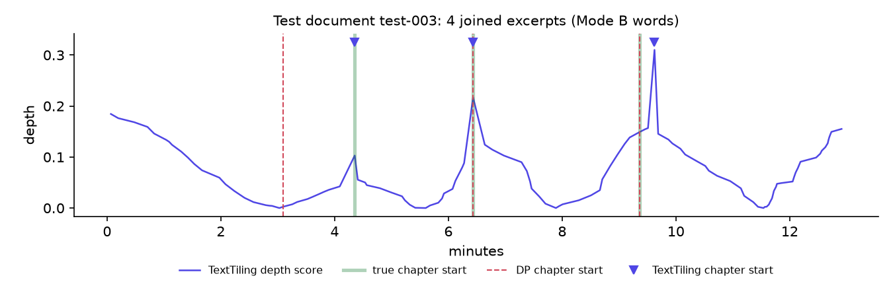

# Audio-Aware Subtitle Correction (English)

Implementation of the course plan in [`imp.md`](imp.md): a modular Python pipeline that
corrects subtitles using the audio as evidence (Mode A: audio + faulty `.srt`/`.vtt`) or
generates and post-corrects them from audio alone (Mode B), with a synthetic-corruption benchmark,
baselines, ablations and a web app (FastAPI backend + React frontend).

> **Results:** see [Results](#results) (filled from `results/` by the evaluation runs).

## Pipeline

```
media ──ffmpeg──► 16 kHz WAV ──faster-whisper──► words + probabilities (cached)
  Mode A: subtitles ─► coarse sync (RANSAC t'=a·t+b on cue-start anchors, piecewise jumps)
                    ─► graded Needleman-Wunsch alignment (anchor-and-fill) ─► evidence fusion
  Mode B: ASR words as the draft
both  ─► punctuation (own BiLSTM) ─► truecasing ─► SymSpell + LanguageTool ─► own Transformer corrector
      ─► audio-consistency guard ─► CTC forced alignment (own acoustic model)
      ─► [speaker diarization, opt-in: pyannote] ─► DP re-segmentation (own POS tagger, speaker-aware)
      ─► cue timing rules ─► .srt / .vtt / change log / HTML diff [+ .rttm / speaker statistics]
      ─► chapter markers: topic segmentation of the corrected words (own POS tagger + LM unigrams)
         ─► .chapters.vtt / .ffmetadata / .chapters.txt / .chapters.json   (the second output)
```

Whisper is the only pretrained model in the default pipeline. The fusion LM, punctuation tagger,
corrector, POS tagger and forced aligner are our own, trained from scratch on this machine (see
[Self-trained models](#self-trained-models)). The optional speaker labels use pyannote.audio, a
second pretrained model, which is off unless you turn it on (see
[Speaker diarization](#speaker-diarization)).

| Module | What it does |
|---|---|
| `src/subfix/subio.py` | `Word`/`Cue` model, SRT/VTT parse + write, tag stripping, sound-event tokens |
| `src/subfix/asr.py` | faster-whisper wrapper (word timestamps + probabilities, JSON cache, GPU→CPU fallback) |
| `src/subfix/sync.py` | anchor-based RANSAC offset/drift fit, piecewise offset jumps, ffsubsync wrapper (B2) |
| `src/subfix/align.py` | graded NW: 0 exact / 0.3 metaphone-equal / 0.4+0.6·d near miss / 1; gap 0.8; time penalty |
| `src/subfix/fuse.py` | imp.md §4.1 decision rule (confidence, phonetics, LM delta, OOV, lexicon), split/merge units |
| `src/subfix/lm.py`, `ngram.py` | window scorer on our modified Kneser-Ney 4-gram LM (NumPy, open vocabulary) |
| `src/subfix/textfix/` | punctuation (our BiLSTM), truecasing, SymSpell + LanguageTool, our Transformer corrector (`seq2seq.py`, BPE in `bpe.py`) with ratio guard, audio guard |
| `src/subfix/timing.py`, `acoustic.py` | our CTC acoustic model (log-mel + conv + BiLSTM) + NumPy CTC Viterbi, or Whisper DTW timings; cue rules |
| `src/subfix/segment.py`, `postag.py` | greedy and POS-aware DP segmentation (≤42 chars, ≤2 lines, CPS, 0.833–7 s, gaps; speaker-aware with labels); our averaged-perceptron POS tagger |
| `src/subfix/diarize.py` | optional pyannote speaker diarization (cached), words → speakers, overlapping speech, speaker turns and statistics, labels, RTTM |
| `src/subfix/chapters.py` | chapter markers: Utiyama-Isahara DP or TextTiling over sentences, content words from our POS tagger, generic words filtered with our LM's unigrams, titles and descriptions, WebVTT / FFmpeg / timestamp-list writers |
| `src/subfix/pipeline.py` | Mode A / B orchestration, text-stage cache, model registry (6 GB GPU budget) |
| `metrics/` | WER/CER, edit and ERRANT F0.5, over-correction, GLEU/BLEU, punctuation F1, timing, format, topic segmentation (Pk, WindowDiff, boundary F1) |
| `tools/` | data download, long-form clips, MFA references, corruption generator, benchmark builder |
| `experiments/` | `train_{lm,pos,punct,corrector,aligner}.py`, `run_eval.py`, `systems.yaml`, `tune_fusion.py`, `eval_chapters.py`, `plots.py`, Colab notebook |
| `app/backend/` | FastAPI server: job queue (one GPU job at a time), SQLite history, REST + Server-Sent Events API |
| `frontend/` | React + TypeScript (Vite) app: upload, live progress, player with captions, diff, cue editor |

### Design decisions that differ from imp.md (and why)

* **Anchor-and-fill alignment instead of per-cue ±2 s windows** — overlapping windows can match or
  insert the same ASR word twice; unique n-gram anchors (LIS-monotonic) + NW between them is still
  linear in file length.
* **Cue-start anchors for sync** — word times inside a cue are only interpolated (badly off for
  merged cues) and cue ends include reading-time extensions; cue starts are the reliable times.
* **Audio-consistency guard** — SymSpell, LanguageTool and the corrector may not substitute/delete a
  word the ASR heard with p ≥ 0.8 (nor insert words between such words). Without it SymSpell
  "corrected" `ravishment`→`banishment` and the earlier T5 model hallucinated "compared *to that
  which is in the water*" on a LibriSpeech clip. Punctuation/casing changes are always allowed.
* **Self-trained models instead of pretrained ones** — imp.md suggests distilgpt2, FullStop XLM-R,
  T5/CoEdIT, MMS-300M and spaCy; all five are replaced by models trained here from scratch
  (an earlier version used them; its numbers are kept in `results/pretrained_v1/` for comparison).
* **Word times from non-blank CTC frames** — a word starts at its first non-blank character frame
  and ends after its last one; padding words into the neighbouring silence (as `ctc-forced-aligner`'s
  `get_spans` does) gave ~0.5 s early subtitle onsets.
* **Whisper `initial_prompt`** — without a punctuated prompt large-v3-turbo sometimes returns
  lowercase, unpunctuated text, which removes the casing evidence used by fusion.
* **Re-merged number pieces** — faster-whisper's word timestamps split "10,000" into "10" + ",000";
  these pieces (and punctuation-only pieces) are merged back into one word before alignment.
* **Onset-based cue timing metric** — matching cues by overlap mixes segmentation differences into
  timing errors; the primary metric is the cue start vs the MFA start of its first word (the
  imp.md cue-pair metric is still reported, with strict Jaccard ≥ 0.8 matching).
* **WhisperX not installed** — Whisper DTW timestamps remain available as the `whisper` timing backend.
* **One punctuation label per word** — the tagger labels whole words (not sub-word pieces), so
  word-level timing and provenance survive punctuation restoration.

## Self-trained models

Whisper (faster-whisper large-v3-turbo, with its Silero VAD) is the only pretrained model the
pipeline runs. Everything else was implemented and trained from scratch in this repository, in plain
PyTorch / NumPy (no `transformers`, no downloaded weights), on the RTX 4050 laptop.
A 30-page report on how they were built (architectures, layer-by-layer parameters, code, data,
results, difficulties, viva Q&A) is in `docs/report/Subfix_Self_Trained_Models.pdf`; rebuild it from
the current models and results with `python docs\report\build_report.py`.

| Component | Replaces | Our model | Training data | Size | Training | Held-out result |
|---|---|---|---|---|---|---|
| Fusion LM (`ngram.py`, `lm.py`) | distilgpt2 (82M) | interpolated modified Kneser-Ney 4-gram, open vocabulary (`<unk>` × character-bigram spelling model), vectorized NumPy counting/lookup | LibriSpeech-PC train text: 563k sentences, 8.5M words | 55.8k words, 13.4M n-grams (237 MB) | 2 min, CPU | perplexity 284 on dev-clean (0.9% OOV) |
| POS tagger (`postag.py`) | spaCy `en_core_web_sm` | averaged perceptron, Brown tags mapped to UD | Brown corpus, 54k sentences | 127k features | 3 min, CPU | 97.2% accuracy (2.9k held-out sentences) |
| Punctuation (`textfix/punct.py`) | FullStop XLM-R large (560M) | word + char-CNN + casing embeddings → 2-layer BiLSTM → {none . , ?} | LibriSpeech-PC train chapters, 8.5M words, half lowercased | 12.3M params | 8 epochs, 40 min | macro-F1 0.81 cased / 0.67 lowercased (dev-clean + dev-other) |
| Corrector (`textfix/seq2seq.py`, `bpe.py`) | vennify T5-base (220M), CoEdIT-large (770M), fine-tuned T5-small (60M) | Transformer encoder-decoder (4 + 3 layers, d = 256), own 8k BPE, beam search | 513k LibriSpeech-PC train sentences with fresh synthetic noise every epoch + real whisper-tiny confusions | 8.4M params | 15 epochs, 76 min (best: epoch 13) | WER 13.9% → 4.3% on noisy dev-clean sentences; 97.6% of clean sentences left unchanged |
| Forced aligner (`acoustic.py`, `timing.py`) | MMS-300M (`ctc-forced-aligner`), wav2vec2-base-960h | 80-band log-mel → 2 conv (20 ms frames) → 4-layer BiLSTM → CTC over 29 characters; our NumPy Viterbi with wildcard edges | LibriSpeech train-clean-100 (28.5k utterances, 100.6 h, 251 speakers) | 9.3M params | 11 epochs, 2 h 56 min | CER 7.9% (greedy, dev-clean); word onsets vs MFA on the dev clips: 25 ms mean / 19 ms median error, 98.6% within 100 ms, after removing the constant 47 ms CTC lag |

Evaluation-only tools still use pretrained models, because they measure the system rather than
being part of it: MFA (`english_us_arpa`) for the silver-gold timing references, spaCy inside ERRANT
and for the reference cue breaks (`tools/make_refs.py`), and whisper-tiny for the real-ASR-error
corruptions (`tools/corrupt.py`) and the corrector's confusion table.

## Setup (Windows, RTX-class GPU or CPU)

```powershell
powershell -ExecutionPolicy Bypass -File scripts\setup_env.ps1      # .venv, CUDA torch, deps, MFA env
.venv\Scripts\python scripts\prefetch_models.py                     # Whisper models (~2.5 GB) + check of our models
.venv\Scripts\python -m pytest                                      # unit + property tests
.venv\Scripts\python -m pytest -m integration                       # 3 golden clips (needs models)
```

Requirements: Python 3.11, Java ≥ 17 for LanguageTool (`JAVA_HOME`), conda for MFA, ffmpeg.
`scripts/fetch_resumable.ps1` resumes large downloads on unstable connections;
`scripts/fetch_parallel.sh` splits one into parallel range requests when a single connection is slow.
Train our models once (every run resumes from `models/*/last.pt`):

```powershell
.venv\Scripts\python experiments\train_lm.py          # ~2 min, CPU
.venv\Scripts\python experiments\train_pos.py         # ~3 min, CPU
.venv\Scripts\python experiments\train_punct.py       # ~40 min, GPU
.venv\Scripts\python experiments\train_corrector.py   # GPU
.venv\Scripts\python tools\fetch_data.py --libri train-clean-100   # 6.3 GB of training audio
.venv\Scripts\python experiments\train_aligner.py     # GPU
```

## Usage

```powershell
# Mode A: correct existing subtitles
.venv\Scripts\subfix correct --media talk.mp4 --subs talk.srt --out outputs
# Mode B: audio only
.venv\Scripts\subfix correct --media talk.mp4 --out outputs
# overrides, domain terms
.venv\Scripts\subfix correct --media a.wav --subs a.vtt --set segment.max_cps=20 gec.enabled=false --lexicon "Kubernetes, Chennai"
# web app (see "Web app" below)
powershell -ExecutionPolicy Bypass -File scripts\start_app.ps1   # builds the frontend once, serves http://127.0.0.1:8000
```

Outputs: `*.srt`, `*.vtt`, `*.changes.json` (every edit with stage, rule, ASR word, probability,
fusion score), `*.diff.html`; with `--diarize` also `*.rttm` and `*.speakers.json`; when the media
is long enough for two or more chapters, the chapter markers `*.chapters.vtt`, `*.ffmetadata`,
`*.chapters.txt` and `*.chapters.json` (`--chapters N` asks for exactly N, `--no-chapters` turns them
off; see [Chapter markers](#chapter-markers-second-output)).

## Speaker diarization

Optional: identify who is speaking with [pyannote.audio](https://github.com/pyannote/pyannote-audio)
and label the cues (`SPEAKER_00: ...`). Off by default; the benchmark numbers below are all without it.

**Setup (once).** pyannote is the one pretrained model besides Whisper, and its pipeline is gated on
Hugging Face:

1. `.venv\Scripts\python -m pip install -r requirements-diarize.txt` (pyannote.audio 4.0.7; the
   setup script does this with `-Diarize`).
2. Signed in to Hugging Face, open
   [pyannote/speaker-diarization-community-1](https://huggingface.co/pyannote/speaker-diarization-community-1)
   and accept its conditions, then create a *read* token at https://huggingface.co/settings/tokens.
3. Put the token in the `HF_TOKEN` environment variable (or store it once with
   `.venv\Scripts\python -m huggingface_hub.cli.hf auth login`). The token never goes into a config
   file. The pipeline is downloaded on the first run and cached; `diarize.model` may also point to a
   local copy of the pipeline folder.

pyannote.audio 4 sends usage telemetry (file duration, speaker counts) to pyannote.ai by default;
subfix sets `PYANNOTE_METRICS_ENABLED=false` unless you set that variable yourself.

```powershell
.venv\Scripts\subfix correct --media meeting.mp4 --out outputs --diarize                 # estimate the speakers
.venv\Scripts\subfix correct --media meeting.mp4 --out outputs --speakers 3              # exactly 3 speakers
.venv\Scripts\subfix correct --media talk.mp4 --subs talk.srt --out outputs --labels change   # name only at changes
```

The same settings live in `configs/default.yaml` under `diarize:` (`--set diarize.max_speakers=4` etc.);
in the web app they are under *Settings → Audio → Identify speakers*.

**What happens.** Diarization runs on the 16 kHz audio after forced alignment (cached by audio
content + settings, like the ASR). pyannote gives two views: regular turns, which may overlap, and an
exclusive view with one speaker at a time.

* **Words → speakers:** each word gets the speaker with the largest overlap in the exclusive view;
  words in a diarization gap take the nearest turn within `max_gap` (1 s), else their neighbours'
  speaker; a one-word "island" covered less than `smooth_cover` (50 %) by its own turn joins the
  speaker of the words on both sides (boundary jitter, not a real interjection).
* **Overlapping speech:** words with ≥ `overlap_min` (50 %) of their duration inside overlapping
  speech are flagged (`overlap_with` in the change log, an *overlap* chip and filter in the web app).
  Whisper transcribes one stream, so in a handover overlap (B starts while A finishes) the exclusive
  view cannot know whose words were heard. The overlapped words are therefore split at the most likely
  handover instead: after a sentence end, else after a clause mark, else at the longest pause.
* **Speaker turns:** the cue segmenter never lets a cue span a speaker change, and a speaker change
  is a free break point. The one exception is a two-line *dialogue cue* with one speaker per line, for
  quick exchanges ("Really?" / "Yes."); its cost is `dialogue_cost`, and `dialogue: false` turns it off.
* **Labels** (`diarize.label`): `every` labels the first line of every cue (and the second line of a
  dialogue cue); `change` labels a line only when the speaker changes; `none` adds no names, and
  dialogue cues get the usual `- ` dashes. Labels count towards the 42-character line limit (the
  layout reserves room for them) but not towards reading speed (CPS), in the segmenter, the format
  metrics and the web app. The `.vtt` also carries WebVTT voice tags (`<v SPEAKER_00>`). Reading a
  labelled file back (Mode A) strips the labels, so corrected output can be corrected again. In the
  web editor a wrong speaker is fixed by editing the label; the edited `.vtt` voice tags follow it.

**Outputs.** `*.rttm` (the regular turns in NIST RTTM, for pyannote.metrics / dscore) and
`*.speakers.json`, which holds:

| Per speaker | |
|---|---|
| `talk_time`, `share` | seconds of speech (union of the speaker's turns) and share of all speech (shares add up to more than 100 % when people overlap) |
| `words`, `wpm` | words attributed to the speaker, words per minute of talk time |
| `turns`, `mean_turn`, `longest_turn` | speaker turns in the transcript (runs of consecutive words) |
| `overlap_time` | seconds this speaker talks while someone else does |
| `interruptions` | turns that start while another speaker is still talking |
| `cues`, `first`, `last` | cues the speaker appears in, first and last time heard |

Totals: speakers, speech and overlap time (and share), turns, speaker changes, mean turn length,
overlapped words and cues, dialogue cues. It also lists every speaker turn (with its text) and every
overlap region. `*.changes.json` gains `speaker` per word and `speakers` per cue.

**Limits.** In overlaps only the words Whisper heard can be labelled: a second voice that Whisper did
not transcribe stays missing. Diarization quality is pyannote's (it drops on very short turns, similar
voices and noisy audio); giving the exact number of speakers helps when it is known. Names are
pyannote's `SPEAKER_nn`, numbered by first appearance. Edit them in the web editor if you want real names.

## Chapter markers (second output)

Next to the subtitles, the pipeline splits the recording into chapters where the topic changes and
names each chapter. It is on by default and adds no model: it reuses our POS tagger and our LM.
Media too short for two chapters of at least `chapters.min_duration` (60 s) gets a single chapter in
the change log and no chapter files.

| File | Use |
|---|---|
| `*.chapters.vtt` | WebVTT chapter track (`<track kind="chapters">`), one cue per chapter with its title |
| `*.ffmetadata` | FFmpeg chapters: `ffmpeg -i talk.mp4 -i talk.corrected.ffmetadata -map 0 -map_metadata 1 -map_chapters 1 -c copy talk.chapters.mp4` |
| `*.chapters.txt` | timestamp list for a video description (`0:00 Title`; YouTube wants at least 3 chapters of 10 s or more) |
| `*.chapters.json` | per chapter: start, end, title, keywords, description sentence, word range, strength of the topic shift (also under `chapters` in `*.changes.json`) |

**How it works** (`src/subfix/chapters.py`):

1. **Units.** The corrected, forced-aligned words are cut into sentences at the restored full
   stops. A run of more than 50 words without one is cut at its longest pause, so unpunctuated text
   works too.
2. **Topic words.** Each sentence becomes a bag of stems of the words our POS tagger tags
   NOUN/PROPN/VERB/ADJ. Closed-class words, fillers and vague words (`thing`, `lot`, `people`, ... in
   `data/lexicons/generic_words.txt`) are dropped. A Porter step-1 stemmer (our implementation:
   plurals, -ed, -ing) merges inflections.
3. **Segmentation.** Utiyama & Isahara (2001): each chapter is scored by the probability of its
   words under its own Laplace-smoothed unigram model, `Σ_t c_t·log((n+k)/(c_t+1))` for counts
   `c_t`, `n` words in the chapter and `k` word types in the recording. Each chapter also costs a
   prior of `penalty · log N`. Dynamic programming over sentence boundaries finds the exact optimum
   under the minimum chapter length, either for any number of chapters or for exactly
   `--chapters N`. `chapters.method: tiling` switches to TextTiling (Hearst 1997: block
   similarity, depth scores, mean − c·σ cutoff).
4. **Times.** A chapter starts at the cue its first word opens, or 0.25 s before that word. The
   first chapter starts at 0:00 and the last ends with the media.
5. **Titles and descriptions.** Titles are the chapter's top three noun phrases, ranked by how
   often they occur in the chapter × how specific their words are (unigram log-probability under
   our Kneser-Ney LM, read from `models/lm/kn4.npz` without loading the higher orders, ~30 ms) ×
   the share of the phrase's occurrences that fall in this chapter. The description is the
   complete sentence closest to the chapter's centroid, with a preference for the chapter's opening.

**Evaluation** (`python experiments\eval_chapters.py`, ~10 min on the CPU; full tables in
`results/chapters/results.md`, examples in `results/chapters/examples.md`).

* **Test documents.** No benchmark recording has chapter annotations, so test documents are built
  the standard way (Choi 2000): 3–6 excerpts (90–300 s, cut at sentence ends) of *different*
  recordings, joined end to end, so every junction is a known topic change.
* **Pauses.** The pause at each junction is drawn from the pauses between sentences, so silence
  gives nothing away.
* **Dev and test sets.** Settings were tuned on 80 documents built from the dev clips, with Mode B
  words and the lowest WindowDiff. The test set is 200 documents from the 26 test clips: 14.5 min
  and 4.5 chapters on average.
* **Metrics.** Pk and WindowDiff are word-level error rates (lower is better; k = half the mean
  chapter length). F1 counts a chapter start found within ±10 s.

| Method (Mode B words) | Pk ↓ | WindowDiff ↓ (95% CI) | F1 @±10 s | chapters (true 4.5) |
|---|---:|---:|---:|---:|
| One chapter | 0.430 | 0.430 | 0.00 | 1.0 |
| Fixed interval (every 3.1 min = dev mean) | 0.441 | 0.441 | 0.11 | 4.8 |
| Random boundaries, true number | 0.483 | 0.501 | 0.08 | 4.5 |
| Even split, true number | 0.366 | 0.366 | 0.12 | 4.5 |
| TextTiling, tuned (400-word blocks) | 0.211 | 0.216 (0.201–0.231) | 0.35 | 4.7 |
| **Utiyama-Isahara DP, tuned (default)** | **0.121** | **0.121 (0.105–0.139)** | **0.73** (P 0.77, R 0.70) | 4.2 |
| DP given the true number of chapters | 0.087 | 0.087 | 0.77 | 4.5 |

* **DP beats TextTiling clearly** (WindowDiff 0.121 vs 0.216, F1 0.73 vs 0.35), as it did on dev
  (0.123 vs 0.177). It optimises the whole recording at once, while TextTiling decides from local
  dips and needed very long blocks to get there.
* **The chapter count is the main error left.** Given the true number of chapters, the DP reaches
  0.087. `--chapters N`, or the number box in the web app, uses that.
* **Robust to recognition errors.** The same settings give WindowDiff 0.121 on Mode B words (audio
  only), 0.122 on Mode A words (corrected subtitles) and 0.113 on the reference transcripts.
* **Ablations** (test):
  * Topic words matter most. Nouns only: 0.208. Nouns + adjectives: 0.168. Adding verbs (the
    default): 0.121.
  * Adding adverbs, or keeping every word, gives 0.113 on test, but tied with the default on dev
    (0.126 / 0.123), so the dev choice stays.
  * Without stemming: 0.129.
  * Dropping words the LM finds common (log-prob above −8): 0.118 on test but 0.132 on dev, so it
    is off by default (`chapters.generic_logp: 0`).
  * Minimum chapter length 30 s or 90 s instead of 60 s: no change (the penalty, not the minimum,
    sets the chapter length).
* **Recall by junction type:** 0.73 between two audiobooks, 0.71 between an audiobook and a talk,
  0.60 between two TED talks (spoken topics drift more and share more vocabulary).
* **Speed:** about 30 ms per 15-minute document after tagging; 0.09 s for the
  chapter stage of an 18-minute talk in the web app.

**Real topic boundaries: AMI meetings** (`python -I tools\fetch_ami.py`, then
`python experiments\eval_chapters.py --stage ami`; full tables in `results/chapters/ami.md`).

* **Data.** The AMI Meeting Corpus manual annotations (CC BY 4.0, 22.9 MB) have topic
  segmentations for 139 meetings: 73 h, 32 min and 8 top-level topics per meeting.
* **Input.** Each meeting's manual transcript, with forced-aligned word times, is merged into one
  stream of utterances, like a diarized transcript, and split into chapters. The result is compared
  with the top-level topics.
* **The topics are finer than chapters.** Median 2.4 min, and a quarter are shorter than the
  60 s minimum chapter length (openings, agenda, chitchat).

| Meetings (all 139, shipped settings unless noted) | Pk ↓ | WindowDiff ↓ | F1 @±30 s | chapters (true 8.0) |
|---|---:|---:|---:|---:|
| One chapter | 0.325 | 0.325 | 0.00 | 1.0 |
| Random boundaries, true number | 0.444 | 0.477 | 0.21 | 8.0 |
| Longest silences, true number (audio only) | 0.315 | 0.362 | 0.37 | 8.0 |
| TextTiling | 0.503 | 0.588 | 0.34 | 13.8 |
| **Utiyama-Isahara DP (shipped)** | 0.330 | 0.345 | 0.21 | 4.0 |
| DP, true number of chapters | 0.352 | 0.389 | 0.39 | 8.0 |

* **Meetings are much harder than the joins.**
  * The shipped settings make half as many chapters as there are annotated topics.
  * About one chapter start in three lands within 30 s of a topic change, at every penalty; random
    boundaries manage one in five.
  * Pk and WindowDiff do not separate the systems here. One chapter scores 0.325, because these
    metrics reward having few boundaries when the topics are short, and F1 rewards having many. So
    the count is a choice of granularity: penalty 1 gives about AMI's 8 topics per meeting.
* **The words are a weaker signal in meetings than silences and discourse markers.**
  * Topic starts follow a median 0.69 s of silence (0 s elsewhere).
  * "okay" opens 24.5% of topic-start sentences vs 6.1% of the others; "so", "right" and
    "alright" behave the same way.
  * Given the true number of chapters on the 20 unseen meetings, the longest silences alone place
    them better than the words (WindowDiff 0.364 vs 0.393).
  * Adding a dev-tuned bonus to the DP for chapter starts that open with a discourse marker helps
    significantly: WindowDiff 0.356, −0.037 (95% CI −0.072 to −0.010). Adding silence on top is
    not significant.
* **Why the bonus is not shipped.** The same weights hurt the LibriSpeech/TED joins: WindowDiff
  0.087 → 0.177 with markers, 0.356 with silence. Tuning for WindowDiff on AMI only drives the
  count down (penalty 12). A meeting mode would need its own tuning of the count and the weights.
* **TextTiling** over-fires on meetings: its relative cutoff gives 14 chapters.

Example (Mode B, `ted-test-DanielKahneman`, no ground truth):

```
0:00 Cognitive traps, glorious music and happiness
2:27 Vacation, colonoscopy and patient
11:23 Happiness, California and correlation
```



**Limits.**

* **Made for talks, lectures and audiobooks.** One main speaker, whose vocabulary shifts with the
  topic. Joined excerpts change speaker, book or talk at every junction, which makes them easier
  than real topic shifts. On real meeting topics (AMI, above) the chapters are much less accurate:
  there, topic changes show in discourse markers and silences more than in vocabulary. The examples
  on whole TED talks read sensibly, but nothing scores them.
* **The penalty was tuned for chapters of about 3 minutes.** For a different granularity, set the
  number of chapters or `chapters.penalty` (lower gives more chapters; about 1 matches the topics of
  the AMI meetings).
* **Titles are keyword lists**, not written headings.
* **Words only.** Silence and discourse markers are not used. On meetings they help, with
  discourse markers the clearer gain, but with the same weights they hurt the joins (see above).
  Prosody (pitch, loudness) is untested.

## Web app

`scripts\start_app.ps1` installs and builds the frontend on first use, then starts the backend and
opens http://127.0.0.1:8000. By hand:

```powershell
cd frontend; npm install; npm run build; cd ..          # once (and after frontend changes)
.venv\Scripts\python -m app.backend                    # --port 8000 --no-browser --data-dir ... --retention-days 30
```

* **New job:** drop a video/audio file (and optionally its `.srt`/`.vtt` for Mode A), add names and
  terms, adjust the settings (reading speed, line length, lines per cue, cue durations, cue
  splitting, which correction steps run, Whisper model, word timing). Settings are remembered.
* **Progress:** jobs run one at a time in a queue; each pipeline stage is shown live (Server-Sent
  Events) with its duration, queue position and a cancel button (a running job stops at the next
  stage). The run log is kept for failed jobs.
* **Review:** the media plays with the corrected or original subtitles drawn over it (words light up
  as they are spoken, from the forced-alignment times); a waveform timeline shows the original and
  corrected cues; the subtitle table colours every replaced / inserted / deleted word (hover for the
  audio evidence: ASR word, confidence, fusion score, rule) and every re-timed cue, with filters
  (text changed, re-timed, too fast) and search; the change log lists every edit by step, including
  the ones the audio guard rejected; the quality tab compares subtitle-guideline compliance before
  and after, stage timings, sync offset/drift and word-timing statistics.
* **Speakers** (with *Identify speakers* on): each cue shows its speaker(s) and an *overlap* chip,
  the table filters by speaker or by overlapping speech, the caption draws the label with the
  speaker's colour, and the *Speakers* tab has a who-spoke-when timeline (overlaps hatched), the
  per-speaker statistics and the list of speaker turns (click to play). The settings warn when the
  server has no pyannote.audio or no Hugging Face token.
* **Chapters** (on by default; number of chapters and shortest chapter in the settings): the
  *Chapters* tab shows a strip of the chapters along the recording and the list of chapters with
  title, length, keywords and description (click to play); the timeline marks every chapter start;
  under the player, previous/next chapter buttons (keys `[` and `]`) and the current chapter's title.
* **Edit and download:** fix any cue's text or times in the browser and save; downloads (`.srt`,
  `.vtt`) then include the edits, and the automatic version stays available, as do the change log
  (`.json`), the HTML diff, the chapter files (WebVTT chapters, FFmpeg metadata, timestamp list,
  `.json`) and, for diarized jobs, the speaker statistics (`.json`) and `.rttm`.
  *Run again* re-processes the same files with other settings.
* **History:** every job with its status and summary, kept in `cache/server/` (SQLite + one folder
  per job; finished jobs older than 30 days are removed at start-up).

Development: `npm run dev` in `frontend/` (Vite on http://localhost:5173, `/api` proxied to the
backend) with `python -m app.backend --reload --no-browser`. Tests: `python -m pytest tests/test_backend.py`
(API with a fake pipeline) and `npm test` in `frontend/` (Vitest). API docs: http://127.0.0.1:8000/api/docs.

| Endpoint | |
|---|---|
| `POST /api/jobs` | multipart: `media`, optional `subs`, `options` (JSON) → job |
| `GET /api/jobs`, `GET /api/jobs/{id}` | history, status snapshot |
| `GET /api/jobs/{id}/events` | live status (Server-Sent Events) |
| `POST /api/jobs/{id}/cancel`, `POST /api/jobs/{id}/rerun`, `DELETE /api/jobs/{id}` | control |
| `GET /api/jobs/{id}/result` | cues, diff rows, edits, metrics |
| `PUT` / `DELETE /api/jobs/{id}/cues` | save / drop manual cue edits |
| `GET /api/jobs/{id}/files/{srt,vtt,json,html,edited_srt,edited_vtt,speakers,rttm,chapters_vtt,chapters_txt,chapters_json,ffmetadata}` | downloads |
| `GET /api/jobs/{id}/media`, `/audio`, `/waveform`, `/log` | playback (Range requests), peaks, run log |
| `GET /api/options`, `GET /api/system` | option defaults and ranges, diarization readiness, device / queue status |

## Benchmark and experiments

```powershell
python tools\build_benchmark.py --stages all            # data, clips, ASR caches, MFA refs, corruption, manifests
python experiments\tune_fusion.py                        # dev-set grid search -> configs/tuned.yaml
python experiments\run_eval.py --manifest test           # main table -> results/test/
python experiments\run_eval.py --manifest test --ablation timing_source --datasets libri-test-clean ted-test
python experiments\run_eval.py --sweep 0.05 0.10 0.20    # corruption-rate sweep
python experiments\plots.py                              # results/plots/*.png
python experiments
un_eval.py --manifest dev --systems modeb_ours ours   # dev outputs the chapter tuning reads
python experiments\eval_chapters.py                      # chapter markers: tune on dev, test -> results/chapters/
python -I tools\fetch_ami.py                             # AMI meeting topic annotations -> data/ami/ (22.9 MB download)
python experiments\eval_chapters.py --stage ami          # chapter markers on real topic boundaries -> results/chapters/ami.md
```

* **Data:** LibriSpeech dev-clean / test-clean / test-other (long-form clips of 3–5 min built from
  consecutive utterances of a chapter, punctuated and cased text from LibriSpeech-PC) and
  TED-LIUM 3 long-form talks (`distil-whisper/tedlium-long-form`, lowercase, no punctuation, so
  punctuation F1 is not reported for TED). Dev = libri-dev-clean (8) + ted-validation (4);
  test = libri-test-clean (8) + libri-test-other (8) + ted-test (11).
* **Silver-gold timing:** Montreal Forced Aligner 3.4.2 (`english_us_arpa`) word times → reference
  cues from the DP segmenter under strict rules (17 CPS, 42 chars, 2 lines).
* **Corruption:** `tools/corrupt.py` (spelling, homophones, real whisper-tiny errors, entities,
  dropped/duplicated words, punctuation/case, offset, fps drift, jitter, split offsets, merges),
  seeded and logged per error.

## Results

Test split: 8 LibriSpeech test-clean + 8 test-other long-form clips (3–5 min) and 11 TED-LIUM talks
(up to 20 min), each with a seeded corrupted subtitle (≈11% injected word errors plus timing and
formatting corruption). GPU: RTX 4050 Laptop (6 GB). Every number below comes from the self-trained
models (Whisper is the only pretrained model). Full tables: `results/test/results.md`,
`results/SUMMARY.md`; per-file numbers: `results/test/per_item.csv`; error analysis:
`results/error_analysis.md`. The earlier version with pretrained models is archived in
`results/pretrained_v1/` (same benchmark, same Whisper ASR).

**Mode A — audio + corrupted subtitles (all 27 test files)**

| System | WER % | ERRANT F0.5 | Edit F0.5 | Over-corr. % | Punct F1 | Onset \|Δt\| ms | Onsets ≤250 ms | Lines ≤42 | CPS ≤20 | RTF |
|---|---|---|---|---|---|---|---|---|---|---|
| Corrupted input (no-op) | 10.88 | 0.0 | 0.0 | 0.00 | 30.6 | 9365 | 7.1% | 82.6% | 97.2% | – |
| B1: SymSpell + LanguageTool | 8.82 | 43.3 | 46.2 | 0.90 | 31.2 | 9362 | 7.1% | 82.9% | 97.4% | 0.037 |
| B2: ffsubsync (timing only) | 11.45 | 0.0 | 0.2 | 0.64 | 30.7 | 5633 | 27.3% | 82.5% | 97.0% | 0.008 |
| B3: raw Whisper replace | 3.10 | 69.5 | 70.7 | 3.48 | **71.3** | 235 | 59.2% | 27.5% | 93.5% | 0.031 |
| **Ours** | **2.75** | **77.1** | **82.2** | **1.41** | 70.1 | **39** | **97.8%** | **100%** | **99.9%** | 0.056 |

**Mode B — audio only**

| System | WER % | Punct F1 | Onset \|Δt\| ms | Onsets ≤250 ms | Lines ≤42 | CPS ≤20 |
|---|---|---|---|---|---|---|
| Raw Whisper large-v3-turbo segments | **3.10** | 71.3 | 235 | 59.2% | 27.5% | 93.5% |
| Ours (punct + truecase + guarded correction + CTC align + DP seg) | 3.20 | **77.7** | **42** | **97.3%** | **100%** | **99.8%** |

Per-dataset WER (Mode A, Ours vs raw Whisper): test-clean 2.16 vs 2.13, test-other 2.48 vs 4.16,
TED 2.93 vs 3.09. Punctuation F1 is scored on LibriSpeech only (TED references have none).

**Self-trained models vs the earlier pretrained ones** (all 27 test files)

| System | WER % | ERRANT F0.5 | Edit F0.5 | Over-corr. % | Punct F1 | Onset \|Δt\| ms | Onsets ≤250 ms | RTF |
|---|---|---|---|---|---|---|---|---|
| v1: distilgpt2 + FullStop XLM-R + T5-base GEC + MMS-300M + spaCy | 3.03 | 75.1 | 80.4 | 1.42 | **72.6** | 50 | 97.1% | 0.058 |
| v1 + fine-tuned T5-small | 2.98 | 75.7 | 81.1 | **1.35** | 72.5 | 50 | 97.2% | 0.056 |
| **Self-trained** (KN 4-gram + BiLSTM punct + Transformer corrector + own CTC + perceptron POS) | **2.75** | **77.1** | **82.2** | 1.41 | 70.1 | **39** | **97.8%** | 0.056 |
| Mode B, v1 | 3.24 | – | – | – | **79.5** | 53 | 96.8% | 0.063 |
| Mode B, self-trained | **3.20** | – | – | – | 77.7 | **42** | **97.3%** | **0.053** |

The honest reading: replacing every pretrained model except Whisper did not cost accuracy overall.
Timing improved: our aligner places cue onsets better than MMS-300M (39 vs 50 ms). The WER gain
(3.03 → 2.75) is mostly *re-tuning*, not a better LM: the n-gram LM scores insertions lower than
distilgpt2, so the dev grid for the LM gate was widened (−3 → −12 nats). That lifted dropped-word
recall from 74.6% to 92.3%, and v1's own no-LM ablation (2.67% on its subset) suggests v1 would have
gained similarly. Punctuation is where the pretrained model was better. FullStop (XLM-R large,
pretrained on 2.5 TB of text) beats our BiLSTM (8.5M words of audiobook text): Mode A punct F1 72.6
vs 70.1 (test-clean 81.8 vs 73.8, test-other 65.7 vs 67.1), Mode B 79.5 vs 77.7. Speed is
unchanged (RTF ≈ 0.056).

**Objectives (imp.md 1.2)**

| # | Target | Result | Met |
|---|---|---|---|
| O1 | ≥30% relative WER reduction on corrupted subtitles | 10.88% → 2.75% (−75%) | yes |
| O2 | Mode B: lower WER and higher punctuation F1 than raw Whisper | punct F1 71.3 → 77.7, but WER 3.10 → 3.20 | partly |
| O3 | ≥90% of cue boundaries within ±250 ms | 97.8% of cue onsets (mean 39 ms) | yes |
| O4 | ≥95% of cues ≤42 chars/line, ≤2 lines, ≤17–20 CPS | 100% / 100% / 99.9% at 20 CPS (92.6% at 17) | yes (20 CPS) |
| O5 | Upload → diff → download demo | web app: `app/backend/` + `frontend/` (+ `tests/test_backend.py`, `npm test`) | yes |

**Per-error-type recall of Ours** (share of injected errors repaired): spelling 97.4%,
homophones 96.7%, dropped words 92.3%, duplicates 85.3%, entities 81.8%, real whisper-tiny
substitutions 42.9%.

**What the numbers say**

* Fusion turns ≈11% corrupted subtitles into 2.75% WER, better than the strong ASR used alone
  (large-v3-turbo, 3.10%), with far fewer wrong edits: raw replacement changes 3.5% of words that
  were already correct, Ours 1.4% (ERRANT F0.5 77 vs 70). Fusion keeps the human subtitle unless the
  audio evidence is strong, and wins most where Whisper is weaker (test-other: 2.48% vs 4.16%).
  Of the residual substitutions, 450 were already in the corrupted subtitle and 107 were introduced.
* Timing and formatting are where the pipeline separates from every baseline: our CTC forced
  alignment puts 98% of cue onsets within ±250 ms (Whisper segments: 59%), and the DP segmenter
  meets the line rules for every cue (Whisper segments: 27.5%).
* The audio-consistency guard still matters (ablation below), but less than with T5: without it WER
  rises from 2.80% to 3.36% (v1: 3.01% → 4.26%). With the guard, the corrector has a minor role —
  running none is marginally best, as it was for every pretrained GEC model in v1.
* Mode B: punctuation improves (Whisper's own marks kept, gaps filled by our tagger), but the text
  correctors, even restricted to low-confidence ASR words, slightly increase WER (3.10 → 3.20).
  Beating large-v3-turbo's WER would need N-best / LLM correction (out of scope here).

**Ablations** (libri-test-clean + ted-test, 19 files)

| Timing source | Word-start \|Δt\| vs MFA (mean / median) | Word start+end \|Δt\| | Cue onset \|Δt\| | Onsets ≤250 ms |
|---|---|---|---|---|
| Whisper DTW timestamps | 110 / 50 ms | 90 ms | 233 ms | 63.4% |
| **Our CTC aligner** (log-mel + BiLSTM, 9.3M params) | **33 / 17 ms** | 57 ms | **42 ms** | **97.4%** |
| *v1: MMS-300M (ctc-forced-aligner)* | *43 / 30 ms* | *43 ms* | *54 ms* | *96.6%* |
| *v1: wav2vec2-base-960h* | *56 / 45 ms* | *53 ms* | *60 ms* | *96.9%* |

Our aligner beats MMS on word starts and cue onsets, but its word *ends* are worse (≈81 ms vs
≈42 ms): CTC fires each character in a short spike, so the last character's spike comes before the
word has finished, and the dev-calibrated onset shift moves ends earlier too. Ends only affect cue
end times, which the cue rules extend anyway; calibrating ends separately is the obvious next step.

| Segmenter | CPS ≤17 | CPS ≤20 | Lines ok | Onset \|Δt\| |
|---|---|---|---|---|
| Greedy | 56.9% | 61.3% | 100% | 35 ms |
| **DP (POS-aware, our tagger)** | **92.8%** | **99.8%** | 100% | 42 ms |

| Audio-consistency guard | WER % | Edit F0.5 | Over-corr. % | Punct F1 | RTF |
|---|---|---|---|---|---|
| **on** (p ≥ 0.8 words protected) | **2.80** | **81.3** | **1.44** | 73.8 | **0.058** |
| off | 3.36 | 76.9 | 1.95 | 73.8 | 0.063 |

| Fusion signals (each variant re-tuned on dev) | WER % | Edit F0.5 | Over-corr. % | Dropped-word recall |
|---|---|---|---|---|
| all signals | 2.80 | 81.3 | 1.44 | 91.6% |
| − ASR confidence | 2.78 | 80.9 | 1.48 | 91.6% |
| − phonetic similarity | 2.83 | **81.4** | **1.42** | 91.6% |
| − LM (also no LM gate for insertions/deletions) | **2.69** | 80.2 | 1.67 | 91.7% |
| − OOV flag | 2.80 | 81.3 | 1.44 | 91.6% |

Single signals are largely redundant. With the wider LM-gate grid the LM no longer blocks dropped
words (recall 91.6% with or without it); it now trades a little WER for precision (over-correction
1.44% vs 1.67%), which is what the dev F0.5 objective asks for (dev F0.5 0.747 with the LM, 0.729
without). OOV is unused: its tuned weight is 0, because the LM's spelling model already penalises
out-of-vocabulary words.

| ASR model (audio evidence) | WER % | Edit F0.5 | Over-corr. % |
|---|---|---|---|
| tiny.en | 4.06 | 78.2 | **1.19** |
| small.en | 3.18 | 81.1 | 1.25 |
| **large-v3-turbo** | **2.80** | **81.3** | 1.44 |

| Corrector (after fusion, with audio guard) | WER % | Edit F0.5 | Over-corr. % | RTF |
|---|---|---|---|---|
| none | **2.76** | **81.7** | **1.38** | **0.054** |
| our Transformer corrector | 2.80 | 81.3 | 1.44 | 0.058 |
| *v1, WER only: none 2.97 / T5-base 3.01 / CoEdIT-large 3.10 / fine-tuned T5-small 2.99* | | | | |

The corrector does not pay off once fusion and the audio guard are in place — exactly as with the
pretrained GEC models in v1. On its own task it works (held-out noisy sentences: 13.9% → 4.3% WER),
but most of what it fixes, fusion has already fixed with the audio as evidence. ASR-size RTFs are
omitted: ASR outputs are cached.

| Injected word-error rate | Corrupted input WER % | Ours WER % |
|---|---|---|
| 5% | 5.29 | 2.41 |
| 10% | 9.87 | 2.80 |
| 20% | 17.46 | 3.14 |

The system degrades gracefully: at 20% injected errors the output is still near 3% WER.

Plots: `results/plots/` — `timing_source.png`, `segmenter.png`, `audio_guard.png`,
`fusion_signals.png`, `asr_size.png`, `gec_model.png`, `corruption_rate.png`.

Coarse sync (`results/sync_recovery.md`, 27 test files): drift (25 vs 23.976 fps) recovered to a
median slope error of 0.0005, all 4 injected offset jumps detected with no false positives, median
offset error 0.23 s (anchors use Whisper word onsets; final timing comes from forced alignment).

Silver-gold references (`results/reference_agreement.json`): when the references were built, MFA
and the independent MMS aligner agreed on word onsets to a mean of 39 ms (median 31 ms; 73% within
50 ms, 96% within 100 ms) over all 39 clips, which bounds the reference's own timing error well below
the ±250 ms tolerance.

**Chapter markers** (the second output): Utiyama-Isahara DP, WindowDiff 0.121 and boundary F1 0.73
on 200 joined test documents (TextTiling 0.216 / 0.35, even split 0.366 / 0.12). On real meeting topics
(AMI, 139 meetings) it is much weaker: WindowDiff 0.345, no better than one chapter (0.325); about a third
of its chapter starts fall within 30 s of a topic change, against a fifth for random boundaries. See
[Chapter markers](#chapter-markers-second-output), `results/chapters/results.md` and `results/chapters/ami.md`.

**Caveats.** Corruptions are synthetic (with real whisper-tiny confusions mixed in) and the references
are verbatim transcripts, so condensed professional subtitles are not represented. Silver-gold timing
comes from MFA and was cross-checked against MMS, not by hand. Our aligner's onset shift (−47 ms)
and its best epoch were chosen against the MFA references of the *dev* clips. The piecewise-sync
heuristic was refined while inspecting sync recovery on dev *and* test files (minor leakage, sync
only); all fusion/punctuation/corrector settings were tuned on dev only. ffsubsync locks onto wrong
offsets on very short clips and cannot model drift + splits. The `own` dataset (Indian-English
recordings) is supported but has no clips yet.

## Licences

Code: no licence chosen yet. Data/models used for this non-commercial course project: TED-LIUM 3
(CC BY-NC-ND 3.0), LibriSpeech and LibriSpeech-PC (CC BY 4.0; our LM, punctuation tagger, corrector
and CTC aligner are trained on them), the Brown corpus via NLTK (POS tagger; see its NLTK licence
notes), Whisper (MIT). Evaluation only: Montreal Forced Aligner `english_us_arpa` models, spaCy
`en_core_web_sm` (MIT), and the AMI Meeting Corpus manual annotations (CC BY 4.0, University of
Edinburgh; topic boundaries for the chapter-marker evaluation).
# sub

