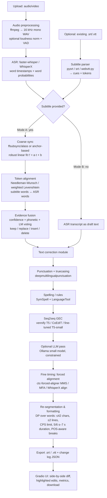

# Implementation Plan: Audio-Aware Subtitle Correction System (English)

The best way to build this in 8–10 weeks is a modular Python pipeline. Whisper (via faster-whisper/WhisperX) supplies the audio evidence. A confidence-weighted Needleman-Wunsch alignment decides which subtitle words to change. A small T5-family model (plus a punctuation tagger) does the text clean-up. A dedicated CTC forced aligner, not Whisper's own timestamps, fixes timing. A dynamic-programming re-segmenter enforces Netflix/BBC rules. Gradio wraps it all as the demo. The single most important design decision is to **separate "what was said" (ASR + fusion) from "when it was said" (forced alignment)**. A June 2026 benchmark by the Montreal Forced Aligner authors (McAuliffe et al., arXiv:2606.18466) found WhisperX word boundaries average about 110 ms of error, versus roughly 20–43 ms for dedicated aligners. That gap decides whether your timing metrics look good or bad.

**Prepared for:** Shane, B.Tech CSE (AI & Data Analytics), Chennai
**Assumed timeline:** 10 weeks (MVP at end of Week 5)
**Constraints:** free/open-source only; runs on a laptop CPU or a free Colab T4 GPU

---

## TL;DR

- **Build a two-mode pipeline that shares every module after ASR.** Mode A (audio + faulty .srt/.vtt) aligns subtitle words against faster-whisper/WhisperX words and fuses them with confidence weighting. Mode B (audio only) skips fusion and goes straight to post-correction. Both then run punctuation/truecasing, GEC, CTC forced alignment, re-segmentation and export.
- **Use the right tool for each error class:** SymSpell/LanguageTool and an ASR-confidence rule engine as the baseline. A T5-family GEC model (vennify T5-base or CoEdIT-large) plus `deepmultilingualpunctuation` as the "improved" system. `ctc-forced-aligner` (MMS-300M) or Montreal Forced Aligner for word timings, and ffsubsync/alass (or your own robust linear fit) for global offset and drift.
- **Prove it is an NLP project with a controlled, synthetic-corruption benchmark.** Built from TED-LIUM 3 / LibriSpeech and reported with WER/CER, ERRANT F0.5/GLEU, punctuation F1, boundary-offset metrics (% within ±100/±250 ms) and CPS/line-length compliance. Include a baseline-vs-improved table and 5–6 ablations.

---

## 1. Problem Statement and Objectives

### 1.1 Problem
Subtitles in the wild are often wrong in three independent ways:

1. **Text:** typos, ASR mis-recognitions (homophones like "their/there", named entities, domain terms), missing or extra words, and missing punctuation or casing.
2. **Timing:** a constant offset (e.g., a release with a different intro), linear drift (e.g., a 23.976 vs 25 fps mismatch), or individually misaligned cues.
3. **Formatting:** lines that are too long, cues that flash too fast to read, and cues split mid-phrase.

Auto-generated subtitles (e.g., raw Whisper output) have the same problems in Mode B.

### 1.2 Objectives
| # | Objective | Measurable target (suggested) |
|---|---|---|
| O1 | Correct text errors in existing subtitles using audio evidence | ≥30% relative WER reduction on synthetically corrupted subtitles |
| O2 | Generate + post-correct subtitles from audio alone | Lower WER and higher punctuation F1 than raw Whisper output |
| O3 | Fix timing | ≥90% of cue boundaries within ±250 ms of reference after correction |
| O4 | Enforce subtitle guidelines | ≥95% of cues ≤42 chars/line, ≤2 lines, ≤17–20 CPS |
| O5 | Demo | Upload → side-by-side diff → download corrected .srt/.vtt |

### 1.3 How this demonstrates core NLP concepts
| NLP concept | Where it appears in the project |
|---|---|
| Tokenization & normalization | Word/subword tokenization of subtitles vs ASR; number/contraction normalization before WER; SentencePiece tokens in T5 |
| Language modeling | LM scoring to arbitrate between subtitle word vs ASR word; Whisper's decoder as an acoustic-conditioned LM; optional LLM rescoring |
| Sequence alignment / edit distance | Needleman-Wunsch / Levenshtein alignment of subtitle tokens vs ASR tokens; WER computation itself |
| Seq2seq correction | T5/Flan-T5 (CoEdIT, vennify) GEC; fine-tuning T5-small/BART on synthetic noisy→clean pairs |
| Sequence labeling | Punctuation restoration as token classification (FullStop/XLM-R) |
| Speech–text alignment | CTC forced alignment (wav2vec2/MMS) of corrected text to audio |
| Structured prediction | DP-based subtitle segmentation with linguistic break constraints (POS tags) |
| Evaluation | WER/CER, ERRANT, GLEU, BLEU, token-level P/R/F1, timing error distributions |

---

## 2. System Architecture

### 2.1 Pipeline diagram



### 2.2 Module responsibilities

| Module | Input → Output | Primary tool | Fallback |
|---|---|---|---|
| `preprocess` | any media → 16 kHz mono WAV | ffmpeg | librosa |
| `subio` | .srt/.vtt ↔ `Cue` objects | `srt` / `pysrt`, `webvtt-py` | hand-written regex parser |
| `asr` | WAV → words with (start, end, prob) | faster-whisper (`word_timestamps=True`) | WhisperX pipeline |
| `sync` | cues + ASR words → globally shifted cues | own RANSAC linear fit on anchors | ffsubsync, alass |
| `align` | subtitle tokens, ASR tokens → alignment ops | own Needleman-Wunsch (NumPy) | `difflib.SequenceMatcher`, `rapidfuzz` |
| `fuse` | alignment + confidences → fused token stream | rule-based weighted voting | logistic-regression decision model (scikit-learn) |
| `textfix` | text → corrected text | punctuation model + T5 GEC | SymSpell + LanguageTool only |
| `timing` | corrected text + WAV → word times | ctc-forced-aligner | WhisperX `align()`; MFA for gold labels |
| `segment` | timed words → cues | DP segmenter + spaCy POS | greedy splitter |
| `export` | cues → .srt/.vtt + diff JSON | `srt` | — |
| `evaluate` | hyp vs ref → metrics | jiwer, errant, custom timing metrics | — |
| `app` | UI | Gradio | Streamlit; Flask + React (stretch) |

---

## 3. Component Choices (2025–2026 State of Practice)

### 3.1 ASR: faster-whisper vs WhisperX

- **faster-whisper** (CTranslate2) is the default engine. Its README shows `WhisperModel("large-v3", device="cpu", compute_type="int8")` for CPU. In its CPU benchmark, the *small* model in int8 transcribed the test audio in 1m42s using 1,477 MB RAM on an Intel i7-12700K (8 threads), or 51 s with batch_size=8.
- **large-v3-turbo** is the sweet spot on Colab. It has 809M parameters and 4 decoder layers, versus 32 in large-v3. In a community benchmark (SYSTRAN/faster-whisper GitHub issue #1030) on 13 minutes of audio, turbo int8 (beam 5) ran in 19.591 s with 1,545 MB GPU memory and 1.919% WER. Full large-v3 int8 took 52.6 s and 2,953 MB.
- **Word confidence:** with `word_timestamps=True`, every word gets a `probability` field. faster-whisper computes this as the mean of the word's token probabilities. This is the main "audio evidence" signal for fusion.
- **WhisperX** adds VAD-based chunking, batched inference and wav2vec2 phoneme forced alignment for word timestamps (Bain et al., INTERSPEECH 2023). The latest stable PyPI release is 3.8.6 (May 25, 2026).
  - **Caveat:** a GitHub issue opened Sep 2, 2025 reports that word-level timestamps from WhisperX's forced alignment became less accurate starting at version 3.3.3. Pin a version and verify timing on a few files yourself.

**Recommendation:** use faster-whisper directly for transcription and confidences, because it is simpler to install and gives probabilities. Do *not* rely on Whisper/WhisperX boundaries for final cue timing (see 3.4).

| Hardware | Model | compute_type | Expected use |
|---|---|---|---|
| Laptop CPU (8–16 GB RAM) | `small.en` / `distil-small.en` | `int8` | development, short clips |
| Colab T4 (16 GB) | `large-v3-turbo` | `float16` or `int8_float16` | experiments, demo recordings |
| Colab T4 | `large-v3` | `float16` | "best quality" ablation only |

### 3.2 Subtitle ↔ ASR alignment
Use **word-level global alignment** (Needleman-Wunsch, i.e., Levenshtein with backtrace) on normalized tokens (lowercase, punctuation stripped, numbers expanded). Implement it yourself in NumPy so it is "your" NLP contribution. Use `difflib`/`rapidfuzz` only as a sanity check. Substitution costs should be graded rather than 0/1:

- cost 0 for identical tokens;
- cost ∝ normalized character edit distance for near-misses ("recieve"/"receive");
- reduced cost for phonetically equal tokens (Double Metaphone via `jellyfish`: "their"/"there");
- cost 1 otherwise; gap cost ≈ 0.7–1.0.

This is the same technique used in research corpus building. The ParCzech4Speech authors aligned WhisperX output to official transcripts word-by-word. They inserted a gap token "if the Levenshtein distance exceeds the length of the official word" rather than forcing an alignment of dissimilar words.

For long files, align **within time windows**: after coarse sync, align each cue's tokens only against ASR words inside [cue_start − 2 s, cue_end + 2 s]. This keeps the work linear in file length and prevents cross-cue mismatches.

### 3.3 Text correction approaches compared

| Approach | Handles | Pros | Cons | Role in plan |
|---|---|---|---|---|
| **SymSpell** (`symspellpy`, `lookup_compound` with the bundled 82,765-word unigram + 243,342 bigram dictionaries) | typos, split/merged words | very fast, deterministic, CPU-only | no context beyond bigrams; can't fix real-word errors | Baseline + pre-filter |
| **LanguageTool** (`language_tool_python`) | grammar rules, agreement, a/an, typos | rule explanations (good for demo); non-AI | local server needs Java ≥17 for LT ≥6.6 (default download is 6.8); ~200 MB | Baseline + explainable edits |
| **Punctuation/truecasing** (`deepmultilingualpunctuation`, FullStop XLM-R models) | `. , ? - :` restoration | trained for transcribed speech; token-classification (nice NLP demo) | trained on Europarl political speeches; casing needs a separate step | Required in both modes |
| **vennify/t5-base-grammar-correction** | grammar, some spelling | ~220M params, runs on CPU; prefix `grammar: ` | trained on JFLEG (learner essays, not speech); CC-BY-NC-SA; may over-edit | Default GEC |
| **grammarly/coedit-large** | grammar, fluency, paraphrase via instructions | Flan-T5-large (770M), instruction prompts ("Fix grammatical errors in this sentence:") | 3.13 GB weights; a user reported 16–17 s per correction on their setup; over-paraphrasing risk | "Improved" GEC on GPU |
| **N-best / confidence-aware ASR correction** | misheard words, homophones, entities | uses the audio evidence directly | needs N-best or confidence features | Core of fusion module |
| **Small LLM (Ollama / HF, 1–4B)** | entities, domain terms, context | strong world knowledge; zero-shot | hallucination, slow on CPU, non-deterministic | Stretch, constrained to flagged spans |
| **Fine-tuned T5-small / BART-base on synthetic pairs** | your exact error distribution | best "NLP course" story; small, fast | needs data generation + training time | Stretch / Week 7 experiment |

**Evidence from the literature that informs the design:**
- **HyPoradise (Chen et al., NeurIPS 2023; arXiv:2309.15701).** It provides more than 334,000 pairs of N-best hypotheses and accurate transcriptions. The authors found that an LLM given a reasonable prompt can even fix tokens missing from the N-best list.
- **N-best T5.** Feeding a T5 corrector more hypotheses lowered LibriSpeech test-clean WER from 3.02 (1-best) to 2.67 (10-best). Use Whisper's beam alternatives or a second, smaller ASR model as extra hypotheses.
- **RoBART.** This work used phoneme sequences from a G2P tool as an extra input, because ASR errors "originate from confusions at the phonetic level". It also generated errors with a deliberately weaker ASR model. Both ideas are cheap to replicate: use `whisper-tiny` as the "weak ASR" error generator.
- **DARAG (ACL Findings 2025).** Synthetic data helps, but its ablation is titled "Real Data Outperforms Synthetic". Mix real Whisper errors into any synthetic training set.

### 3.4 Timing correction: which aligner for what

A 2026 benchmark by the Montreal Forced Aligner (MFA) authors on TIMIT word boundaries (mean error; % within 100 ms) found:
- **MFA 3.0 (ARPA):** 19.93 ms, 98.38% within 100 ms.
- **MMS (CTC):** 43.06 ms, 95.91%.
- **WhisperX:** 110.04 ms, only 53.98% within 100 ms.

The authors note that ASR-based aligners leave gaps between words, so scoring choices matter (they scored word start times). Even so, the gap is too large to ignore.

| Tool | What it fixes | Strength | Weakness | Use in plan |
|---|---|---|---|---|
| **ffsubsync** (0.4.17) | global offset (and framerate) | `pip install`, VAD + FFT cross-correlation; author says it usually finishes in 20–30 s | not per-cue; fails with ads/cuts | Baseline sync |
| **alass** (Rust CLI) | offset + splits (cuts/ads) | DP algorithm; handles split points | external binary | Baseline for "split" corruptions |
| **Own anchor-based fit** | offset + linear drift | uses high-confidence matched words as anchors; RANSAC → t' = a·t + b | needs enough matches | Main coarse sync (your contribution) |
| **ctc-forced-aligner** (MMS-300M) | word-level times for *corrected* text | at least 5× less memory than TorchAudio's API; CLI `--language "eng" --romanize` | default model CC-BY-NC-4.0 | Main fine alignment |
| **WhisperX `align()`** | word times (wav2vec2) | already installed | ~110 ms mean error in benchmark | Fallback |
| **Montreal Forced Aligner 3.0** | word + phone times, highest accuracy | <15 ms mean phone boundary error in 2026 paper | conda install, slower, more setup | Create *silver-gold* timing references |
| **aeneas** | sentence/fragment sync via TTS+DTW | simple | needs eSpeak + compiled C extensions; old docs prefer Python 2.7 | Not recommended |

### 3.5 Formatting rules to encode

| Rule | Netflix (English) | BBC | Plan default |
|---|---|---|---|
| Max chars/line | 42 | 37 (Teletext broadcast); online = 68% of 16:9 width | 42 (configurable) |
| Max lines | 2 | 2 recommended | 2 |
| Reading speed | English (USA) TTSG: up to 20 CPS adult / 17 children; Subtitle Templates guide: up to 17 CPS adult / 15 children | BBC Subtitle Guidelines: 160–180 WPM (0.33–0.375 s per word); minimum ≈0.3 s per word on screen (e.g., 1.2 s for 4 words) | 17 CPS strict / 20 CPS lenient (report both) |
| Duration | min 5/6 s, max 7 s | — | 0.833 s – 7 s |
| Gap between cues | ≥2 frames | — | ≥83 ms (2 frames @ 24 fps) |
| Line breaks | after punctuation; before conjunctions/prepositions; never split article–noun or noun–adjective; prefer bottom-heavy | at natural linguistic units | encoded as DP break costs using spaCy POS |

---

## 4. Evidence Fusion: Deciding Which Words to Correct (Mode A)

This is the heart of the "audio-aware" claim. After alignment, each position is one of: **match**, **substitution** (sub word *s* vs ASR word *a*), **deletion** (word only in subtitle) or **insertion** (word only in ASR).

**Key design principle: be conservative.** Professional subtitles are often *edited* (condensed) rather than verbatim, because speech can exceed reading speed. Pablo Romero-Fresco's analysis of BBC programmes found speakers reaching 245 WPM in interviews and weather reports, against a 160–180 WPM subtitle guideline. Never "restore" every dropped filler word. Only change text when the evidence is strong.

### 4.1 Decision rule (baseline, interpretable)
For a substitution (s → a), compute:

```
score(a over s) = w1·p_asr(a)                      # Whisper word probability
                + w2·phon_sim(s, a)                # Double Metaphone / G2P similarity
                + w3·[LM(a | ctx) − LM(s | ctx)]   # LM log-prob difference (GPT-2/distilgpt2 or KenLM)
                + w4·[s ∉ dictionary]              # SymSpell OOV flag on subtitle word
                + w5·[a ∈ domain_lexicon]          # entity/term list from video title or user
replace s with a  if score > τ_sub
```

- **Deletions (subtitle word, no ASR word):** delete only if the word is a likely duplicate ("the the") or the ASR is highly confident in that span (mean p > 0.9) *and* the LM prefers deletion.
- **Insertions (ASR word missing from subtitle):** insert only content words with p > τ_ins that the LM supports. Ignore fillers ("um", "you know") to respect condensation.
- **Matches:** keep, but still pass through punctuation/casing.
- **Tuning:** tune the weights `w1..w5` and thresholds on a dev split by grid search to maximize F0.5 (precision-weighted, as in GEC).

### 4.2 Learned variant (stretch, uses your scikit-learn skills)
Treat every non-match alignment op as a binary classification ("accept ASR edit?"). Features: p_asr, phonetic similarity, char edit distance, LM delta, POS tags, OOV flags, word length, cue CPS. Train logistic regression or gradient boosting on synthetic-corruption data, where the label is known. This becomes an ablation: rules vs learned fusion.

### 4.3 Optional LLM arbitration
Only for low-margin cases (|score − τ| small), send a constrained prompt to a small local model via Ollama. Give it the cue context, the subtitle word, the ASR word and up to 3 alternatives, and require it to answer with one of the given options. Constraining the LLM to a closed choice is what keeps it from hallucinating.

---

## 5. Datasets and Synthetic Corruption

### 5.1 Datasets

| Dataset | Size / license | Use |
|---|---|---|
| **TED-LIUM 3** | 452 h, 2,351 talks; CC BY-NC-ND 3.0 | Main evaluation domain (talks ≈ subtitle-like speech); legacy dev/test split |
| **LibriSpeech** | ~1,000 h read English, 16 kHz; CC BY 4.0 | Clean-speech eval; test-clean/test-other for ASR baselines |
| **Common Voice English** (v26.0, Jun 2026) | 3,780.95 h recorded (2,784.88 h validated), 100,172 speakers; CC0 | Accent diversity (incl. Indian English) for robustness tests; short clips |
| **OpenSubtitles v2018 (OPUS)** | 3,735,070 files, 22.10G tokens across 62 languages; raw per-subtitle XML includes timestamps | Text-side training data for GEC/punctuation fine-tuning; real CPS/line-length statistics |
| **JFLEG / W&I+LOCNESS / CoEdIT data** | GEC benchmarks | Sanity-check GEC models; ERRANT format |
| **Own recordings** (5–10 clips, e.g., NPTEL-style lectures you record, Indian-English accents) | your own | Demo + qualitative error analysis |

**Licensing note:** TED-LIUM (NC-ND), vennify (NC-SA) and the MMS aligner weights (NC) are fine for a non-commercial course project. State this in the report.

### 5.2 Building references
- **Text reference:** the dataset's human transcript (TED-LIUM STM, LibriSpeech text). Restore punctuation in it only for display. For punctuation F1 use OpenSubtitles/TED transcripts that already have punctuation.
- **Timing reference ("silver gold"):** run MFA 3.0 on the reference transcript and audio to get word times. Then build reference cues with your segmenter using the strict rules. Hand-check about 10 minutes to report the silver reference's own error.

### 5.3 Synthetic corruption generator (`corrupt.py`)
Apply controllable, logged corruptions to clean reference subtitles:

| Category | Operation | Default rate |
|---|---|---|
| Spelling | char insert/delete/swap/substitute (keyboard-adjacent) | 3% of words |
| Homophones | swap from a homophone list (their/there/they're, to/too/two, ...) | 2% |
| ASR-style | replace with words from real `whisper-tiny` errors on the same audio (RoBART-style weak ASR) | 3% |
| Entities | perturb proper nouns phonetically (Double Metaphone neighbors) | 30% of entities |
| Missing/extra words | drop function words; duplicate words | 2% / 1% |
| Punctuation/case | strip all, or randomly drop 50% of marks; lowercase | per file |
| Timing: offset | shift all cues by U(−5 s, +5 s) | per file |
| Timing: drift | scale times by 25/23.976 (≈1.0427) or 23.976/25 | 30% of files |
| Timing: jitter | per-boundary noise N(0, 300 ms) | per cue |
| Timing: split | add an offset jump at a random point (simulated ad cut) | 20% of files |
| Formatting | merge 2–3 cues; produce 60+ char lines | 20% of cues |

Keep a JSON log of every injected error so you can compute **per-error-type recall** (a strong report table).

---

## 6. Evaluation Plan

### 6.1 Metrics

| Aspect | Metric | Tool |
|---|---|---|
| Text accuracy | WER, CER (normalized: lowercase, no punctuation) | `jiwer` (v4.0.0, Jun 2025) |
| Edit quality | ERRANT P/R/F0.5 (span-based, per error type); GLEU; BLEU (secondary) | `errant` (v3.0.2), `sacrebleu` or NLTK GLEU |
| Over-correction | % of correct words wrongly changed (false-positive rate) | custom |
| Punctuation | per-class P/R/F1 for `. , ?` and macro-F1; casing accuracy | scikit-learn |
| Timing | mean/median absolute boundary offset (start and end); % boundaries within ±100 ms and ±250 ms; drift residual | custom (`metrics/timing.py`) |
| Formatting | % cues with ≤42 chars/line, ≤2 lines, CPS ≤17 (and ≤20), duration in [0.833, 7] s, gap ≥83 ms | custom |
| Efficiency | real-time factor (processing time / audio duration) on CPU and T4 | timer |

**Timing metric definition:** align hypothesis cues to reference cues by text overlap. Then for each matched pair compute |start_h − start_r| and |end_h − end_r|. Report the mean, the median and the fraction within each tolerance.

### 6.2 Results table to fill in (planned)

| System | WER ↓ | CER ↓ | ERRANT F0.5 ↑ | Punct F1 ↑ | Mean |Δt| ms ↓ | % ≤250 ms ↑ | CPS ok % ↑ | Lines ok % ↑ |
|---|---|---|---|---|---|---|---|---|
| Corrupted input (no-op) | | | | | | | | |
| B1: SymSpell + LanguageTool | | | | | | | | |
| B2: ffsubsync only (timing) | | | | | | | | |
| B3: Raw Whisper replace (Mode B style) | | | | | | | | |
| **Ours: fusion + punct + T5 GEC + CTC align + DP seg** | | | | | | | | |
| Ours + LLM arbitration (stretch) | | | | | | | | |
| Ours + fine-tuned T5-small (stretch) | | | | | | | | |

Report the table separately for **TED-LIUM test**, **LibriSpeech test-other** and **your own Indian-English clips**. That shows robustness, not only in-domain performance.

### 6.3 Suggested ablations
1. **Fusion signals:** remove ASR confidence / phonetic similarity / LM delta one at a time.
2. **Rules vs learned fusion** (logistic regression).
3. **GEC model:** none vs vennify T5-base vs CoEdIT-large vs fine-tuned T5-small (WER, F0.5 and over-correction rate).
4. **ASR size:** tiny vs small vs large-v3-turbo. How much does better audio evidence help correction?
5. **Timing source:** Whisper DTW timestamps vs WhisperX align vs ctc-forced-aligner (vs MFA as upper bound).
6. **Segmenter:** greedy vs DP (CPS compliance and linguistic-break quality).
7. **Corruption rate sweep:** 5% / 10% / 20% word errors. Where does the system break?

---

## 7. Tech Stack and Repository Structure

### 7.1 Key libraries (pin exact versions in `requirements.txt` in Week 1)

| Purpose | Library (version notes) |
|---|---|
| Python | 3.10 or 3.11 (`language_tool_python` requires ≥3.10) |
| ASR | `faster-whisper` (1.x), `whisperx==3.8.6` (optional; verify timestamps, see issue #1220) |
| Forced alignment | `ctc-forced-aligner` (MahmoudAshraf97 GitHub version), optionally `montreal-forced-aligner` via conda |
| Sync | `ffsubsync==0.4.17`, `alass` binary (optional) |
| Subtitles | `srt`, `pysrt`, `webvtt-py` |
| Text | `symspellpy`, `language_tool_python` (+ Java 17), `deepmultilingualpunctuation`, `transformers`, `torch`, `sentencepiece`, `spacy` (`en_core_web_sm`), `jellyfish`, `rapidfuzz` |
| Optional LLM | `ollama` Python client |
| Evaluation | `jiwer==4.0.0`, `errant==3.0.2`, `sacrebleu`, `scikit-learn`, `pandas`, `matplotlib` |
| UI | `gradio` (main), `streamlit` (alt) |
| Testing | `pytest`, `hypothesis` (property tests for the segmenter) |

### 7.2 Folder layout

```
audio-aware-subtitles/
├── README.md
├── requirements.txt / environment.yml
├── configs/
│   └── default.yaml            # model names, thresholds, CPS/line limits
├── data/
│   ├── raw/                    # TED-LIUM, LibriSpeech subsets (gitignored)
│   ├── refs/                   # reference SRTs (silver-gold via MFA)
│   ├── corrupted/              # synthetic corrupted SRTs + JSON error logs
│   └── lexicons/homophones.txt
├── src/subfix/
│   ├── preprocess.py           # ffmpeg → wav
│   ├── subio.py                # parse/write srt/vtt; Cue dataclass
│   ├── asr.py                  # faster-whisper wrapper → Word list
│   ├── sync.py                 # anchor RANSAC fit; ffsubsync wrapper
│   ├── align.py                # Needleman-Wunsch with graded costs
│   ├── fuse.py                 # evidence fusion rules / classifier
│   ├── textfix/
│   │   ├── punct.py            # punctuation + truecasing
│   │   ├── spell.py            # SymSpell + LanguageTool
│   │   ├── gec.py              # T5/CoEdIT wrapper
│   │   └── llm.py              # optional Ollama arbitration
│   ├── timing.py               # ctc-forced-aligner wrapper, cue timing rules
│   ├── segment.py              # DP re-segmentation
│   ├── pipeline.py             # Mode A / Mode B orchestration
│   └── diff.py                 # word-level diff → HTML for UI
├── tools/
│   ├── corrupt.py              # synthetic corruption generator
│   └── make_refs.py            # MFA-based reference builder
├── metrics/
│   ├── text_metrics.py         # jiwer, errant, punct F1
│   ├── timing.py               # boundary offsets, tolerance %
│   └── format_metrics.py       # CPS, line length, duration compliance
├── experiments/
│   ├── run_eval.py
│   └── notebooks/              # Colab notebooks (ASR + training)
├── app/
│   └── gradio_app.py
└── tests/
    ├── test_subio.py
    ├── test_align.py
    ├── test_segment.py
    └── fixtures/
```

---

## 8. Code Skeletons

### 8.1 Data model and subtitle I/O (`subio.py`)
```python
from dataclasses import dataclass, field
from datetime import timedelta
import srt

@dataclass
class Word:
    text: str
    start: float | None = None   # seconds
    end: float | None = None
    prob: float = 1.0            # ASR confidence (1.0 for subtitle words)
    source: str = "sub"          # "sub" | "asr" | "fused"

@dataclass
class Cue:
    index: int
    start: float
    end: float
    text: str
    words: list[Word] = field(default_factory=list)

def read_srt(path: str) -> list[Cue]:
    with open(path, encoding="utf-8-sig") as f:
        subs = list(srt.parse(f.read()))
    return [Cue(s.index, s.start.total_seconds(), s.end.total_seconds(),
                s.content.replace("\n", " ").strip()) for s in subs]

def write_srt(cues: list[Cue], path: str) -> None:
    subs = [srt.Subtitle(i + 1, timedelta(seconds=c.start),
                         timedelta(seconds=c.end), c.text)
            for i, c in enumerate(cues)]
    with open(path, "w", encoding="utf-8") as f:
        f.write(srt.compose(subs))
# VTT: use webvtt-py, or convert SRT→VTT (comma→dot in timestamps + "WEBVTT" header).
```

### 8.2 ASR with word confidences (`asr.py`)
```python
from faster_whisper import WhisperModel
from .subio import Word

def transcribe(wav: str, model_size="large-v3-turbo", device="cuda",
               compute_type="int8_  float16") -> list[Word]:
    model = WhisperModel(model_size, device=device, compute_type=compute_type)
    segments, info = model.transcribe(wav, language="en", beam_size=5,
                                      word_timestamps=True, vad_filter=True)
    words = []
    for seg in segments:                      # generator → iterate once
        for w in seg.words or []:
            words.append(Word(w.word.strip(), w.start, w.end, w.probability, "asr"))
    return words
# CPU: transcribe(wav, "small.en", device="cpu", compute_type="int8")
```

### 8.3 Graded Needleman-Wunsch alignment (`align.py`)
```python
import numpy as np, re, jellyfish
from rapidfuzz.distance import Levenshtein

def norm(t: str) -> str:
    return re.sub(r"[^\w']", "", t.lower())

def sub_cost(a: str, b: str) -> float:
    a, b = norm(a), norm(b)
    if a == b: return 0.0
    if jellyfish.metaphone(a) == jellyfish.metaphone(b): return 0.3   # homophone-ish
    d = Levenshtein.normalized_distance(a, b)
    return 0.4 + 0.6 * d if d < 0.5 else 1.0

def align(sub: list[str], asr: list[str], gap: float = 0.8):
    n, m = len(sub), len(asr)
    D = np.zeros((n + 1, m + 1)); D[:, 0] = np.arange(n + 1) * gap; D[0, :] = np.arange(m + 1) * gap
    for i in range(1, n + 1):
        for j in range(1, m + 1):
            D[i, j] = min(D[i-1, j-1] + sub_cost(sub[i-1], asr[j-1]),
                          D[i-1, j] + gap, D[i, j-1] + gap)
    ops, i, j = [], n, m                      # backtrace
    while i > 0 or j > 0:
        if i > 0 and j > 0 and np.isclose(D[i, j], D[i-1, j-1] + sub_cost(sub[i-1], asr[j-1])):
            ops.append(("match" if norm(sub[i-1]) == norm(asr[j-1]) else "sub", i-1, j-1)); i, j = i-1, j-1
        elif i > 0 and np.isclose(D[i, j], D[i-1, j] + gap):
            ops.append(("del", i-1, None)); i -= 1
        else:
            ops.append(("ins", None, j-1)); j -= 1
    return ops[::-1]
```

### 8.4 Evidence fusion (`fuse.py`)
```python
def fuse(sub_words, asr_words, ops, lm, cfg):
    out = []
    for op, i, j in ops:
        if op == "match":
            out.append(sub_words[i])                       # keep subtitle surface form
        elif op == "sub":
            s, a = sub_words[i], asr_words[j]
            ctx = [w.text for w in out[-5:]]
            score = (cfg.w_conf * a.prob
                     + cfg.w_phon * phon_sim(s.text, a.text)
                     + cfg.w_lm * (lm.logp(a.text, ctx) - lm.logp(s.text, ctx))
                     + cfg.w_oov * is_oov(s.text))
            out.append(a if score > cfg.tau_sub else s)
        elif op == "ins":
            a = asr_words[j]
            if a.prob > cfg.tau_ins and not is_filler(a.text) and lm_supports_insert(lm, out, a):
                out.append(a)
        elif op == "del":
            s = sub_words[i]
            if not (is_duplicate(out, s) or span_confident_without(asr_words, j_ctx=None)):
                out.append(s)
    return out   # also emit an edit log for the UI diff
```

### 8.5 Text correction chain (`textfix/`)
```python
from deepmultilingualpunctuation import PunctuationModel
from transformers import AutoTokenizer, AutoModelForSeq2SeqLM

punct = PunctuationModel()   # oliverguhr/fullstop-punctuation-multilang-large

def restore_punct(text: str) -> str:
    out = punct.restore_punctuation(text)
    return truecase(out)       # capitalize sentence starts, "i"→"I", NER-based proper nouns (spaCy)

class GEC:
    def __init__(self, name="vennify/t5-base-grammar-correction", prefix="grammar: "):
        self.tok = AutoTokenizer.from_pretrained(name)
        self.model = AutoModelForSeq2SeqLM.from_pretrained(name)
        self.prefix = prefix   # CoEdIT: "Fix grammatical errors in this sentence: "
    def __call__(self, sents: list[str]) -> list[str]:
        enc = self.tok([self.prefix + s for s in sents], return_tensors="pt",
                       padding=True, truncation=True, max_length=128)
        out = self.model.generate(**enc, num_beams=4, max_length=128)
        return self.tok.batch_decode(out, skip_special_tokens=True)

def guarded_gec(src: str, hyp: str, max_ratio=0.25) -> str:
    """Reject GEC outputs that change too much (prevents paraphrasing/hallucination)."""
    from rapidfuzz.distance import Levenshtein
    return hyp if Levenshtein.normalized_distance(src.split(), hyp.split()) <= max_ratio else src
```
Run GEC **per sentence** (not per cue), because cues cut sentences mid-way. Map edits back to word positions with ERRANT-style alignment so timing and diff highlighting survive.

### 8.6 Timing: coarse fit + forced alignment (`sync.py`, `timing.py`)
```python
import numpy as np
from sklearn.linear_model import RANSACRegressor, LinearRegression

def fit_offset_drift(anchor_pairs):
    """anchor_pairs: [(sub_time, asr_time)] for high-confidence exact matches."""
    X = np.array([[s] for s, _ in anchor_pairs]); y = np.array([a for _, a in anchor_pairs])
    r = RANSACRegressor(LinearRegression(), residual_threshold=0.5).fit(X, y)
    a, b = r.estimator_.coef_[0], r.estimator_.intercept_
    return a, b       # apply t' = a*t + b to every cue; |a-1| reveals fps drift

def finalize_cue_times(cues, words, min_dur=0.833, max_dur=7.0, min_gap=0.083, lead_in=0.0):
    for c in cues:
        c.start = max(0.0, c.words[0].start - lead_in)
        c.end = max(c.words[-1].end, c.start + min_dur)
        c.end = min(c.end, c.start + max_dur)
    for prev, nxt in zip(cues, cues[1:]):          # enforce gaps
        if nxt.start - prev.end < min_gap:
            prev.end = max(prev.start + 0.5, nxt.start - min_gap)
    return cues
# Word times for corrected text: run ctc-forced-aligner (MMS-300M) on the full corrected
# transcript, e.g. CLI: ctc-forced-aligner --audio_path a.wav --text_path t.txt --language eng --romanize
```

### 8.7 DP re-segmentation (`segment.py`)
```python
def seg_cost(words, i, j, cfg, pos):
    text = " ".join(w.text for w in words[i:j])
    dur = words[j-1].end - words[i].start
    lines = best_two_line_split(text, cfg.max_chars, pos[i:j])   # returns None if impossible
    if lines is None or dur > cfg.max_dur: return float("inf")
    cps = len(text.replace(" ", "")) / max(dur, 1e-3)   # choose & document your CPS counting convention
    cost = max(0, cps - cfg.max_cps) ** 2 * 10
    cost += break_penalty(words[j-1], words[j] if j < len(words) else None, pos)  # e.g. 0 after ".", high between DET-NOUN
    cost += 0.5 if dur < cfg.min_dur else 0
    return cost + 1.0                                   # per-cue cost discourages over-splitting

def segment(words, cfg, pos):
    n = len(words); best = [0.0] + [float("inf")] * n; back = [0] * (n + 1)
    for j in range(1, n + 1):
        for i in range(max(0, j - cfg.max_words), j):
            c = best[i] + seg_cost(words, i, j, cfg, pos)
            if c < best[j]: best[j], back[j] = c, i
    cuts, j = [], n
    while j > 0: cuts.append((back[j], j)); j = back[j]
    return cuts[::-1]   # → build Cue objects, then finalize_cue_times()
```

### 8.8 Pipeline orchestration (`pipeline.py`)
```python
def run(media_path, sub_path=None, cfg=DEFAULT):
    wav = to_wav(media_path)
    asr_words = transcribe(wav, cfg.asr_model, cfg.device, cfg.compute_type)
    if sub_path:                                              # Mode A
        cues = read_subs(sub_path)
        cues = apply_linear(cues, *fit_offset_drift(find_anchors(cues, asr_words)))
        words = []
        for c in cues:                                        # windowed alignment
            win = asr_window(asr_words, c.start - 2, c.end + 2)
            words += fuse(tokens(c), win, align([w.text for w in tokens(c)], [w.text for w in win]), LM, cfg)
    else:                                                     # Mode B
        words = asr_words
    text = restore_punct(" ".join(w.text for w in words))
    text = " ".join(guarded_gec(s, h) for s, h in zip(sents(text), GEC_MODEL(sents(text))))
    timed = forced_align(wav, text)                           # ctc-forced-aligner
    cues_out = build_cues(timed, segment(timed, cfg, pos_tags(timed)), cfg)
    return cues_out, edit_log(...)
```

---

## 9. Demo UI (Gradio)

**Why Gradio over Flask + React:** you get file upload, audio/video players, HTML diff rendering and a download button in about 60 lines. It also runs inside Colab with a public share link, which removes deployment risk on demo day. Keep Flask + React as a stretch goal if you want to show full-stack skills.

```python
import gradio as gr
from subfix.pipeline import run
from subfix.diff import html_side_by_side

def process(media, subfile, max_cps, max_chars, use_gec):
    cfg = DEFAULT.replace(max_cps=max_cps, max_chars=max_chars, use_gec=use_gec)
    cues, log = run(media, subfile, cfg)
    out_path = write_both_formats(cues)          # .srt and .vtt
    return html_side_by_side(log), metrics_table(cues, log), out_path

demo = gr.Interface(
    fn=process,
    inputs=[gr.File(label="Audio / Video"), gr.File(label="Subtitle (.srt/.vtt, optional)"),
            gr.Slider(12, 25, 17, label="Max CPS"), gr.Slider(32, 48, 42, label="Max chars/line"),
            gr.Checkbox(True, label="Use T5 GEC")],
    outputs=[gr.HTML(label="Original vs Corrected (diff)"), gr.Dataframe(label="Metrics"),
             gr.File(label="Download corrected subtitles")],
    title="Audio-Aware Subtitle Correction")
demo.launch(share=True)
```

**Diff view details:** use per-word colors. Green = inserted, red strikethrough = deleted, amber = substituted (tooltip shows the ASR word, its confidence and which rule fired), blue = timing changed (show old → new time). Add a CPS column flagged red when it exceeds the limit. Optionally show a waveform with cue boundaries before and after (matplotlib image).

---

## 10. Hardware and Compute Considerations

| Task | Laptop CPU | Colab T4 (free) |
|---|---|---|
| ASR | `small.en` int8 (CPU int8 benchmark: 1m42s, 1.48 GB RAM on an i7-12700K) | `large-v3-turbo` fp16/int8_float16 (19.6 s for 13 min audio, ~1.5 GB VRAM) |
| Punctuation (XLM-R large) | OK for short files (seconds–minutes) | fast |
| GEC vennify T5-base (~220M) | OK, batch sentences | fast |
| GEC CoEdIT-large (770M, 3.13 GB) | slow; avoid | OK in fp16 |
| ctc-forced-aligner (MMS-300M) | OK for ≤10 min files | fast |
| Fine-tune T5-small on 50–100k pairs | impractical | ~1–2 h per run (estimate; checkpoint to Drive) |
| Small LLM via Ollama (1–4B, quantized) | slow but feasible only for flagged spans | use HF transformers instead (Ollama is awkward on Colab) |

**Practical tips:**
- Free Colab sessions disconnect. Cache ASR outputs as JSON per file so experiments never re-run ASR.
- Use `vad_filter=True` to avoid Whisper hallucinating text in silence/music, a classic subtitle failure.
- Keep demo clips at 1–3 minutes so the live demo finishes in under a minute.

---

## 11. Week-by-Week Timeline (10 weeks)

| Week | Goals | Deliverable / milestone |
|---|---|---|
| **1** | Literature skim (WhisperX, HyPoradise, N-best T5, ERRANT, Netflix/BBC rules); environment set up locally + Colab; pin versions; download TED-LIUM 3 test + LibriSpeech test-clean/other subsets | `requirements.txt`, repo skeleton, 1-page design doc |
| **2** | `subio`, `preprocess`, `asr` (faster-whisper with word probs, JSON cache); Mode B end-to-end with naive cue grouping; jiwer WER on 10 files | Mode B "hello world" SRT |
| **3** | `tools/corrupt.py` + MFA silver-gold references; `metrics/` (text, timing, format) | Benchmark v1 (corrupted + reference pairs, error logs) |
| **4** | `align.py` (graded NW), `sync.py` (RANSAC offset/drift + ffsubsync baseline), `fuse.py` rules; baselines B1–B3 | Baseline numbers in results table |
| **5** | Punctuation + truecasing, SymSpell/LanguageTool, ctc-forced-aligner timing, greedy segmenter, export; **minimal Gradio app** | **MVP: both modes work end-to-end in UI** |
| **6** | T5 GEC (vennify) with guard; DP segmenter with spaCy POS breaks; per-error-type evaluation | "Improved system" v1 numbers |
| **7** | Tune fusion weights on dev split; learned fusion (logistic regression); start ablations; *stretch:* fine-tune T5-small on synthetic + real Whisper-error pairs | Ablation table draft |
| **8** | Ablations complete (ASR size, timing source, GEC model, segmenter, corruption rate); Indian-English own-clip evaluation; *stretch:* CoEdIT and LLM arbitration | Final results tables + plots |
| **9** | UI polish (diff colors, tooltips, metrics, waveform); error analysis (10 worst cases); unit/integration tests green | Demo-ready app, test report |
| **10** | Report, slides, demo video backup, code cleanup + README | Final submission |

**MVP (end of Week 5):** both input modes; Whisper-guided word replacement; punctuation restoration; global offset/drift fix + forced-aligned cue times; 42-char/2-line/CPS-aware splitting; .srt/.vtt export; Gradio upload/diff/download; WER and timing metrics on the benchmark.

**Stretch goals (prioritized):**
1. Learned fusion classifier.
2. Fine-tuned T5-small/BART ASR-error corrector.
3. CoEdIT-large comparison.
4. Constrained LLM arbitration via Ollama.
5. N-best hypotheses from beam search.
6. alass-style handling of split offsets.
7. Flask + React front-end.
8. Speaker-change dashes with WhisperX diarization.

---

## 12. Risks and Mitigations

| Risk | Likelihood | Impact | Mitigation |
|---|---|---|---|
| Dependency hell (torch/CUDA vs WhisperX vs pyannote) | High | High | Use faster-whisper + ctc-forced-aligner as the core path; keep WhisperX optional; separate Colab env; pin versions in Week 1 |
| WhisperX timestamp regression (issue #1220) | Medium | Medium | Don't depend on WhisperX timings; validate on 3 hand-checked clips |
| Whisper hallucinations in music/silence | Medium | Medium | `vad_filter=True`; drop words with very low prob in non-speech regions |
| GEC over-editing / paraphrasing spoken style | High | Medium | edit-distance guard; per-sentence application; report over-correction rate; F0.5 tuning |
| Subtitles intentionally condensed → system "restores" words wrongly | High | Medium | Conservative insertion rule; ignore fillers; evaluate on condensed references too |
| Java missing for LanguageTool on demo machine | Medium | Low | LanguageTool optional; SymSpell fallback; or run LT in Colab |
| Colab GPU quota/disconnects | Medium | Medium | Cache ASR JSON; checkpoint training to Drive; CPU fallback models |
| Synthetic errors ≠ real errors | High | Medium | Include real `whisper-tiny` errors (RoBART-style) and own recordings; DARAG shows real data beats synthetic |
| Silver-gold timing references have their own error | Medium | Medium | Hand-check ~10 min; report reference error; use ±100/±250 ms tolerances |
| Licensing (NC models/data) | Low | Low | Non-commercial academic use only; state in report |

---

## 13. Testing Strategy

- **Unit tests (pytest):**
  - SRT/VTT round-trip (parse → write → parse is identical).
  - The alignment on hand-made cases (substitution, insertion, deletion, homophone).
  - Fusion decisions on fixed toy inputs.
  - Timing rules (min/max duration, gaps).
- **Property tests (hypothesis):** for any word stream, the segmenter output must:
  - preserve all words in order;
  - never exceed 2 lines;
  - keep line length ≤ max_chars unless a single word is longer;
  - produce monotonic, non-overlapping times.
- **Golden-file integration tests:** 3 short clips with expected outputs committed to `tests/fixtures`. CI fails if WER or timing metrics regress by more than a threshold.
- **Corruption-recovery tests:** inject a known +2.0 s offset and 1.0427 drift. Assert that the recovered `a,b` are within 50 ms / 0.001.
- **Manual QA checklist before demo:** play the corrected SRT in VLC/mpv on 3 clips and check sync by eye. Watch for cues that flash too fast and for awkward line breaks.

---

## 14. Course Deliverables

### 14.1 Report outline (≈15–25 pages)
1. Abstract
2. Introduction & motivation (accessibility, subtitle quality standards)
3. Background: ASR (Whisper), forced alignment (CTC, HMM-GMM/MFA), GEC (seq2seq, ERRANT), ASR error correction (HyPoradise, N-best T5), subtitle guidelines (Netflix/BBC)
4. System design (architecture diagram, two modes)
5. Methods: alignment algorithm, fusion scoring, text correction chain, timing (RANSAC + forced alignment), DP segmentation
6. Data: datasets, silver-gold reference construction, corruption generator
7. Experiments & results: main table, per-error-type recall, ablations, robustness on Indian-English clips
8. Error analysis (qualitative examples with diffs)
9. Limitations & ethics (condensation vs verbatim, accent bias, licensing)
10. Conclusion & future work
11. Appendix: configs, hyperparameters, UI screenshots

### 14.2 Presentation / demo plan (10–12 min)
1. **(1 min)** Problem: show a badly synced, typo-ridden subtitle playing over a clip.
2. **(2 min)** Architecture diagram; map each block to an NLP concept.
3. **(4 min)** **Live demo:**
   - (a) Mode A: upload a clip with a corrupted SRT, show the diff with amber homophone fixes, timing shifts and split long lines, then download and play in VLC.
   - (b) Mode B: audio only, comparing raw Whisper vs corrected output.
4. **(3 min)** Results table + 2 ablation plots (timing source; GEC model vs over-correction).
5. **(1 min)** Limitations and future work. Keep a recorded demo video as backup.

---

## 15. Caveats

- **Benchmark figures are indicative, not guarantees.** The faster-whisper speed/memory numbers come from the project README and a community GitHub benchmark on specific hardware. Your Colab T4 numbers will differ. Measure the real-time factor yourself.
- **The WhisperX vs MFA timing comparison comes from MFA's own authors.** They also note that ASR aligners leave inter-word gaps, which makes scoring choices matter. Treat it as strong motivation for the timing ablation, not as settled fact. Your own ablation (Section 6.3 #5) will tell you what holds on subtitle data.
- **Netflix reading-speed limits differ between documents.** The US English style guide says 20 CPS for adult programs, while the general subtitle-template page lists 17 CPS. Make CPS a configurable parameter and report both.
- **CoEdIT latency (16–17 s per correction) is one user's report** on an unspecified setup, not an official benchmark.
- **Training-time estimates for T5-small fine-tuning are my estimates**, not sourced measurements.
- **The OpenSubtitles timestamped raw XML format** is confirmed only by third-party parsers and reports, not by OPUS documentation. Verify the download format in Week 1 before relying on it.

---

## 16. Resource Directory (tools, models, papers, datasets)

**ASR & alignment**
- faster-whisper: github.com/SYSTRAN/faster-whisper
- WhisperX: github.com/m-bain/whisperX (PyPI `whisperx` 3.8.6). Paper: Bain, Huh, Han, Zisserman, "WhisperX: Time-Accurate Speech Transcription of Long-Form Audio", INTERSPEECH 2023 (arXiv:2303.00747)
- ctc-forced-aligner: github.com/MahmoudAshraf97/ctc-forced-aligner; model `MahmoudAshraf/mms-300m-1130-forced-aligner`
- Montreal Forced Aligner. Paper: McAuliffe et al., "Montreal Forced Aligner and the state of speech-to-text alignment in 2026" (arXiv:2606.18466)
- Rousso et al., "Tradition or Innovation: A Comparison of Modern ASR Methods for Forced Alignment", INTERSPEECH 2024 (arXiv:2406.19363)
- ffsubsync: pypi.org/project/ffsubsync (0.4.17); alass: github.com/kaegi/alass

**Text correction**
- symspellpy: github.com/mammothb/symspellpy
- language_tool_python: github.com/jxmorris12/language_tool_python
- deepmultilingualpunctuation / FullStop: huggingface.co/oliverguhr/fullstop-punctuation-multilang-large. Guhr et al., "FullStop: Multilingual Deep Models for Punctuation Prediction", SwissText 2021
- vennify/t5-base-grammar-correction (Hugging Face; trained on JFLEG)
- grammarly/coedit-large (Hugging Face). Raheja et al., "CoEdIT: Text Editing by Task-Specific Instruction Tuning", EMNLP 2023 Findings
- HyPoradise: Chen et al., NeurIPS 2023 Datasets & Benchmarks (arXiv:2309.15701)
- N-best T5: Ma et al., INTERSPEECH 2023 (arXiv:2303.00456)
- RoBART: "Error Correction in ASR using Sequence-to-Sequence Models" (arXiv:2202.01157)
- DARAG: "Failing Forward: Improving Generative Error Correction for ASR with Synthetic Data and Retrieval Augmentation", ACL Findings 2025 (arXiv:2410.13198)

**Evaluation**
- jiwer: pypi.org/project/jiwer (4.0.0)
- ERRANT: github.com/chrisjbryant/errant. Bryant, Felice, Briscoe, "Automatic Annotation and Evaluation of Error Types for Grammatical Error Correction", ACL 2017

**Guidelines**
- Netflix Partner Help Center: "English (USA) Timed Text Style Guide" and "Timed Text Style Guide: Subtitle Templates"
- BBC Subtitle Guidelines (bbc.github.io/subtitle-guidelines)

**Datasets**
- TED-LIUM 3: Hernandez et al., SPECOM 2018 (arXiv:1805.04699); HF `LIUM/tedlium`
- LibriSpeech: openslr.org/12 (Panayotov et al., ICASSP 2015)
- Common Voice: mozilladatacollective.com / github.com/common-voice/cv-dataset
- OpenSubtitles: opus.nlpl.eu (v2018). Lison & Tiedemann, "OpenSubtitles2016: Extracting Large Parallel Corpora from Movie and TV Subtitles", LREC 2016; Lison, Tiedemann & Kouylekov, LREC 2018
- CoEdIT dataset: HF `grammarly/coedit`; JFLEG: HF `jhu-clsp/jfleg`