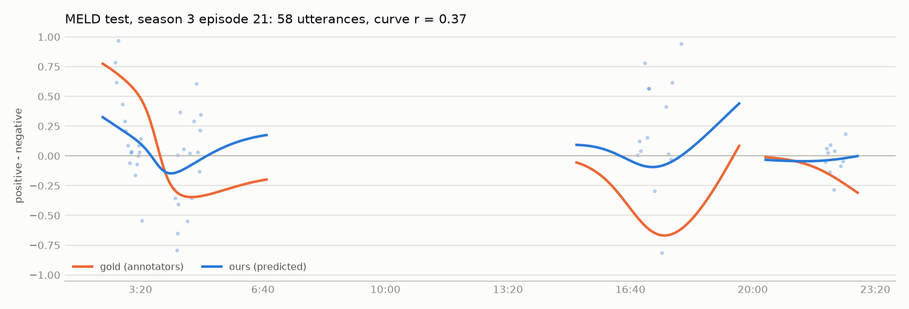

# Sentiment classifier

Logistic regression on TF-IDF unigrams + bigrams with negation marking; C = 1.0, MELD examples weighted x1 (chosen on dev). Trained on 159,273 SST phrases + 9,989 MELD utterances. Three classes.

| System | SST-3 accuracy | SST-3 macro-F1 | SST-2 accuracy | MELD accuracy | MELD weighted-F1 | MELD macro-F1 | curve r (MELD episodes) |
|---|---|---|---|---|---|---|---|
| Majority class (neutral) | 17.6 | 10.0 | 49.9 | 48.1 | 31.3 | 21.7 | – |
| SST word lexicon | 52.0 | 43.6 | 62.8 | 37.1 | 37.2 | 36.0 | 0.15 |
| Ours, trained on SST only | 68.4 | 58.7 | 84.7 | 42.5 | 42.7 | 40.7 | 0.24 |
| Ours, trained on MELD only | 19.5 | 14.3 | 53.8 | 66.0 | 64.5 | 61.2 | 0.45 |
| Ours, SST + MELD (shipped) | 66.3 | 59.5 | 84.8 | 64.7 | 64.1 | 61.2 | 0.40 |

SST test: 2,210 sentences; MELD test: 2,610 utterances. SST-2 = the positive and negative SST test sentences, labelled by whichever of P(positive), P(negative) is higher. Curve r = Pearson correlation of the smoothed gold and predicted sentiment (30 s Gaussian, as in the app) over the utterances of each MELD test episode, averaged over 99 episodes; utterance-level r = 0.44.

Per-class F1 of the shipped model:

| | negative | neutral | positive |
|---|---|---|---|
| SST | 70.2 | 30.4 | 77.8 |
| MELD | 54.3 | 74.4 | 55.0 |

Confusion matrix on MELD test (rows gold, columns predicted; neg / neu / pos):

- neg: [414, 282, 137]
- neu: [176, 991, 89]
- pos: [102, 136, 283]

Strongest features per class:

- neg: bad, lacks, dull, worst, too, fails, lacking, stupid, dumb, mess, flat, unfunny, tired, boring, worse
- neu: well ,, no ., no ,, hey, okay, too bad, fine ., all that, is ,, century, hi ., , but, so ,, reason, yeah ,
- pos: funny, good, enjoyable, great, fascinating, beautiful, best, fun, beautifully, hilarious, entertaining, powerful, terrific, compelling, brilliant

