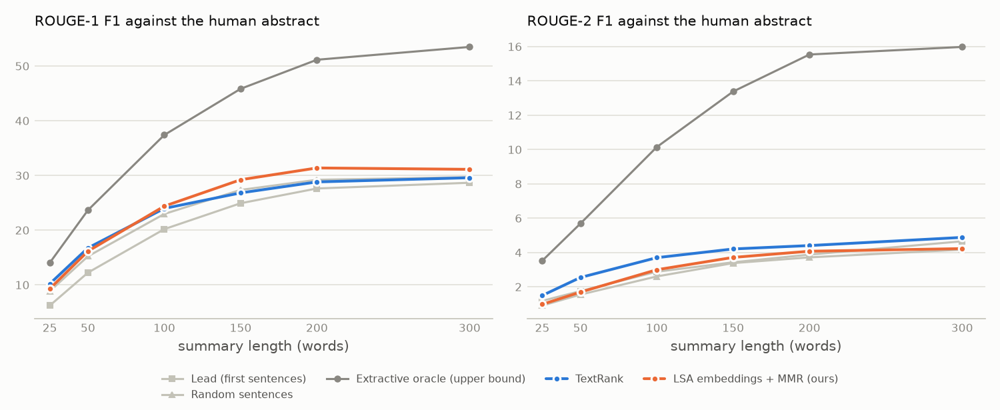

# Summaries on the AMI meeting corpus

20 unseen test meetings (official AMI split), manual transcripts. ROUGE F1 x 100 with stemming; mean over meetings with a 95% bootstrap CI. Every summary is cut to the word budget.

## Overview (150 words) against the human abstract

| System | ROUGE-1 | ROUGE-2 | ROUGE-L | ROUGE-Lsum | words | picked sentences in the human extract |
|---|---|---|---|---|---|---|
| Lead (first sentences) | 24.9 (22.7-27.0) | 3.4 (2.7-4.2) | 13.7 (12.8-14.7) | 23.1 (21.2-25.0) | 158 | 18% |
| Random sentences | 27.4 (26.2-28.6) | 3.4 (3.0-3.8) | 14.3 (13.8-14.7) | 25.0 (23.9-26.1) | 160 | 30% |
| TextRank | 26.8 (25.0-28.8) | 4.2 (3.4-5.1) | 14.3 (13.4-15.3) | 24.0 (22.4-25.5) | 163 | 38% |
| TF-IDF centroid + MMR | 27.5 (25.4-29.5) | 3.8 (3.1-4.5) | 13.3 (12.5-14.1) | 25.0 (22.9-26.9) | 162 | 34% |
| LSA embeddings + MMR (ours) | 29.2 (27.3-31.2) | 3.7 (3.0-4.4) | 14.9 (14.2-15.5) | 25.7 (24.0-27.4) | 157 | 38% |
| Extractive oracle (upper bound) | 45.8 (43.5-48.2) | 13.4 (12.0-14.9) | 21.5 (20.3-22.9) | 40.7 (38.4-42.9) | 156 | 40% |

Words = mean length before the cut (the LLM is asked for at most the budget; extractive systems fill it). Picked sentences in the human extract = share of the sentences a system picks that overlap a dialogue act the AMI annotators marked as summary-worthy.

## Granularity: ROUGE-2 F1 at each level

| System | headline (25 w, abstract) | overview (150 w, abstract) | detailed (300 w, all sections) | chapter (50 w, topic sentences) |
|---|---|---|---|---|
| Lead (first sentences) | 1.2 (0.5-2.1) | 3.4 (2.7-4.2) | 5.0 (4.3-5.8) | 4.0 (3.0-5.2) |
| Random sentences | 0.9 (0.7-1.1) | 3.4 (3.0-3.8) | 5.0 (4.5-5.6) | 3.0 (2.2-4.0) |
| TextRank | 1.5 (0.9-2.2) | 4.2 (3.4-5.1) | 5.9 (5.0-6.8) | 3.2 (2.4-4.4) |
| TF-IDF centroid + MMR | 1.4 (1.0-1.9) | 3.8 (3.1-4.5) | 5.2 (4.6-5.9) | 3.8 (2.7-5.0) |
| LSA embeddings + MMR (ours) | 1.0 (0.5-1.5) | 3.7 (3.0-4.4) | 4.9 (4.3-5.5) | 3.5 (2.6-4.5) |
| Extractive oracle (upper bound) | 3.5 (2.7-4.6) | 13.4 (12.0-14.9) | 16.3 (14.7-18.0) | 12.1 (9.9-14.5) |

ROUGE-1 F1 at the same levels:

| System | headline | overview | detailed | chapter |
|---|---|---|---|---|
| Lead (first sentences) | 6.2 | 24.9 | 30.3 | 19.1 |
| Random sentences | 8.9 | 27.4 | 32.8 | 18.7 |
| TextRank | 10.2 | 26.8 | 33.2 | 19.7 |
| TF-IDF centroid + MMR | 9.6 | 27.5 | 33.1 | 20.9 |
| LSA embeddings + MMR (ours) | 9.3 | 29.2 | 33.2 | 20.9 |
| Extractive oracle (upper bound) | 14.0 | 45.8 | 52.7 | 37.0 |

## Paired differences

Mean difference over meetings (x 100) with a 95% paired-bootstrap CI and two-sided p.

| Comparison | level | metric | difference | 95% CI | p |
|---|---|---|---|---|---|
| embed vs textrank | overview | rouge1 | +2.41 | +0.90 to +3.97 | 0.002 |
| embed vs textrank | overview | rouge2 | -0.49 | -1.37 to +0.34 | 0.260 |
| embed vs textrank | overview | rougeL | +0.54 | -0.41 to +1.40 | 0.266 |
| embed vs textrank | chapter | rouge1 | +1.18 | +0.04 to +2.21 | 0.040 |
| embed vs textrank | chapter | rouge2 | +0.25 | -0.44 to +0.92 | 0.480 |
| embed vs textrank | chapter | rougeL | +0.41 | -0.52 to +1.32 | 0.392 |
| embed vs textrank | detailed | rouge1 | -0.07 | -1.30 to +1.26 | 0.891 |
| embed vs textrank | detailed | rouge2 | -0.97 | -1.85 to -0.04 | 0.042 |
| embed vs textrank | detailed | rougeL | -0.01 | -0.66 to +0.66 | 0.966 |
| embed vs tfidf | overview | rouge1 | +1.76 | -0.35 to +3.76 | 0.094 |
| embed vs tfidf | overview | rouge2 | -0.05 | -0.88 to +0.74 | 0.925 |
| embed vs tfidf | overview | rougeL | +1.59 | +0.61 to +2.55 | 0.003 |
| embed vs tfidf | chapter | rouge1 | +0.03 | -0.69 to +0.83 | 0.977 |
| embed vs tfidf | chapter | rouge2 | -0.30 | -0.76 to +0.18 | 0.218 |
| embed vs tfidf | chapter | rougeL | +0.02 | -0.56 to +0.67 | 0.981 |
| embed vs tfidf | detailed | rouge1 | +0.09 | -1.37 to +1.49 | 0.882 |
| embed vs tfidf | detailed | rouge2 | -0.32 | -1.02 to +0.41 | 0.368 |
| embed vs tfidf | detailed | rougeL | +0.47 | -0.14 to +1.11 | 0.141 |
| embed vs lead | overview | rouge1 | +4.30 | +2.13 to +6.58 | 0.000 |
| embed vs lead | overview | rouge2 | +0.29 | -0.49 to +1.09 | 0.471 |
| embed vs lead | overview | rougeL | +1.18 | +0.00 to +2.34 | 0.049 |
| embed vs lead | chapter | rouge1 | +1.81 | +0.79 to +2.86 | 0.001 |
| embed vs lead | chapter | rouge2 | -0.52 | -1.03 to +0.03 | 0.066 |
| embed vs lead | chapter | rougeL | +0.42 | -0.32 to +1.08 | 0.264 |
| embed vs lead | detailed | rouge1 | +2.83 | +0.83 to +4.82 | 0.004 |
| embed vs lead | detailed | rouge2 | -0.13 | -0.96 to +0.64 | 0.735 |
| embed vs lead | detailed | rougeL | +0.97 | +0.25 to +1.72 | 0.010 |
| oracle vs embed | overview | rouge1 | +16.62 | +14.54 to +18.71 | 0.000 |
| oracle vs embed | overview | rouge2 | +9.66 | +8.39 to +10.95 | 0.000 |
| oracle vs embed | overview | rougeL | +6.62 | +5.45 to +7.88 | 0.000 |
| oracle vs embed | chapter | rouge1 | +16.08 | +14.35 to +17.95 | 0.000 |
| oracle vs embed | chapter | rouge2 | +8.62 | +7.06 to +10.31 | 0.000 |
| oracle vs embed | chapter | rougeL | +11.46 | +9.97 to +13.13 | 0.000 |
| oracle vs embed | detailed | rouge1 | +19.54 | +17.74 to +21.27 | 0.000 |
| oracle vs embed | detailed | rouge2 | +11.38 | +9.94 to +12.93 | 0.000 |
| oracle vs embed | detailed | rougeL | +6.38 | +5.16 to +7.66 | 0.000 |

## Settings

- TextRank: min 10 words per sentence, MMR lambda 1.0, redundancy cut 1.0 (tuned on the 20 dev meetings: objective 0.1295)
- TF-IDF centroid + MMR: min 10 words per sentence, MMR lambda 0.5, redundancy cut 0.5 (tuned on the 20 dev meetings: objective 0.1333)
- LSA embeddings + MMR (ours): min 10 words per sentence, MMR lambda 0.5, redundancy cut 0.5, 300 LSA dimensions (tuned on the 20 dev meetings: objective 0.1386)
